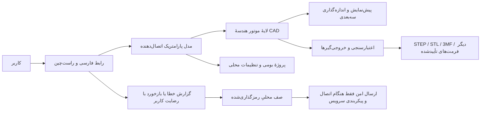

# 🧭 پرامپت مادر — Sahand Screw & Nut Designer

> **کاربرد:** این فایل، نقطهٔ شروعِ کار به هوش مصنوعیِ توسعه‌دهنده است. برای دریافت مشخصات کامل، این فایل را همراه با هر هفت سند پیوندشده به عامل بدهید. اگر عامل به مخزن دسترسی دارد، از او بخواهید همهٔ اسناد را قبل از تغییر فایل‌ها بخواند.
>
> **نام انگلیسی:** Sahand Screw & Nut Designer<br>
> **نام فارسی:** طراح پیچ و مهره سهند

---

## 📋 متن اصلی پرامپت برای عامل هوش مصنوعی

```text
نقش تو یک تیم بین‌رشته‌ای باتجربه است: مدیر محصول، مهندس مکانیک و طراحی اتصال‌دهنده‌ها، متخصص رزوه و ساخت افزایشی، معمار نرم‌افزار دسکتاپ ویندوز، توسعه‌دهندهٔ سه‌بعدی/CAD، طراح تجربهٔ کاربری فارسی و مهندس آزمون و امنیت.

در این مخزن، نرم‌افزار ویندوزی واقعی و قابل اجرا با نام انگلیسی «Sahand Screw & Nut Designer» و نام فارسی «طراح پیچ و مهره سهند» را طراحی و پیاده‌سازی کن. زبان اصلی تمام رابط کاربری فارسی و راست‌چین باشد. هدف، ساخت ابزار پارامتریک برای طراحی دامنهٔ گسترده‌ای از پیچ‌ها، مهره‌ها و اتصال‌دهنده‌های رزوه‌دار، پیش‌نمایش سه‌بعدی، ذخیرهٔ پروژه، خروجی‌گیری قابل اعتماد و آماده‌سازیِ کنترل‌شده برای چاپ سه‌بعدی است.

پیش از کدنویسی:
1) وضعیت مخزن، فایل‌های موجود، شاخه، محیط اجرا، SDKها و وابستگی‌های فعلی را بررسی کن؛ هیچ فایل یا قابلیتی را بدون بررسی حذف یا جایگزین نکن.
2) این پرامپت و تمام هفت سند پیوندشده در جدول «اسناد تکمیلی» را کامل بخوان؛ سند کیفیت کد و قانون کامنت‌نویسی نیز جزو الزامات پیاده‌سازی است. اگر به فایل‌های پیوندشده دسترسی نداری، این محدودیت را صریح بگو و درخواست دریافت آن‌ها را بکن؛ ادعا نکن که آن‌ها را خوانده‌ای.
3) نیازهای ناسازگار یا ناممکن را با راهکار فنی شفاف حل کن. پرسش فقط وقتی مطرح کن که تصمیمِ ایمن و معقولی ممکن نباشد؛ در غیر این صورت فرض‌ها را ثبت کن و ادامه بده.

هنگام پیاده‌سازی:
- فقط طرح مفهومی یا ماکاپ تحویل نده؛ محصول را مرحله‌به‌مرحله در همین مخزن بساز، اجرا و آزمون کن.
- هیچ دکمهٔ نمایشی، دادهٔ ساختگیِ جا زده‌شده به‌عنوان استاندارد، خروجیِ خالی با پسوند معتبر، یا پیام موفقیتِ نادرست باقی نگذار.
- یک موتور هندسهٔ موجود و دارای مجوز سازگار انتخاب کن؛ هستهٔ CAD را از صفر ننویس. انتخاب کتابخانه، مجوز، محدودیت‌ها و وابستگی‌های بومی را مستند کن. برای کارهایی که واقعاً پشتیبانی نمی‌شوند، گزینه را صادقانه غیرفعال یا «در برنامهٔ توسعه» علامت بزن؛ ادعای پشتیبانی نکن.
- هستهٔ طراحی، پیش‌نمایش، ذخیره و خروجی‌گیری باید بدون اینترنت کار کند. فونت‌ها، آیکون‌ها، کتابخانه‌های لازم و پیش‌نیازهای اجرا باید همراه نصب‌کننده یا بستهٔ آفلاین باشند.
- «تمام انواع ممکن» را وعدهٔ ریاضیِ نامحدود تلقی نکن. دامنهٔ وسیعِ خانواده‌های رایج را با کاتالوگ قابل گسترش، پارامترهای سفارشی، پروفیل رزوهٔ سفارشی و سازندهٔ فرم سفارشی پوشش بده؛ محدودیت هر نوع را آشکار و مستند کن.
- ارسال ایمیل در نبود شبکه ممکن نیست. گزارش خطا و بازخورد را محلی صف‌بندی کن و فقط بعد از رضایت کاربر، در صورت وجود اتصال و تنظیم سرویس ارسال، بفرست. هیچ گذرواژه یا کلید سرویس را در کد، مخزن، گزارش یا فایل پروژه قرار نده.
- برای اطلاعات تماس و حمایت سازنده از سند معماری استفاده کن؛ شمارهٔ کارت را در گزارش‌ها/تله‌متری/فایل پروژه وارد نکن. نمایش شمارهٔ کارت فقط در صفحهٔ حمایت باشد و به‌صورت پوشیده، با امکان آشکارسازی و کپی آگاهانه.
- تمام قواعد سند [کیفیت کد و کامنت‌نویسی](prompts/07-code-comments.md) را رعایت کن: کامنت‌ها به فارسی و دربارهٔ دلیل/قیدهای مهم باشند، API عمومی مستند شود، واحدها و قراردادهای هندسی روشن باشند، و کامنت بدیهی/منسوخ یا secret نوشته نشود.

پس از هر مرحله، build و آزمون مرتبط را اجرا کن. در پایان، خلاصهٔ قابلیت‌های واقعاً پیاده‌سازی‌شده، دستور اجرا، دستور build/test، خروجی‌های تولیدشده، محدودیت‌های شناخته‌شده، وضعیت پشتیبانی هر فرمت و کارهای باقی‌مانده را دقیق گزارش کن. هرگز قابلیت آزمون‌نشده را «تأییدشده» معرفی نکن.
```

---

## 🗂️ اسناد تکمیلی که باید خوانده شوند

| ترتیب | سند | چرا لازم است؟ |
|---:|---|---|
| ۱ | [چشم‌انداز محصول و دامنه](prompts/01-product-scope.md) | تعریف مسئله، کاربران، خانواده‌های اتصال‌دهنده و مرزهای واقعی محصول |
| ۲ | [رابط کاربری و فارسی‌سازی](prompts/02-ui-ux-persian.md) | طراحی فارسی/RTL، وزیرمتن، صفحات، فرم‌ها و آیکون‌ها |
| ۳ | [موتور پارامتریک و هندسه](prompts/03-parametric-geometry.md) | پارامترها، رزوه‌ها، هندسهٔ پیچ و مهره و سازگاری قطعات |
| ۴ | [چاپ سه‌بعدی و خروجی](prompts/04-printing-and-export.md) | بهینه‌سازی چاپ، فرمت‌های سه‌بعدی و تنظیم کیفیت |
| ۵ | [معماری، آفلاین و حریم خصوصی](prompts/05-architecture-offline-privacy.md) | معماری فنی، گزارش ایمیلی، اطلاعات سازنده و امنیت |
| ۶ | [آزمون و معیار پذیرش](prompts/06-testing-acceptance.md) | آزمون‌های ضروری، معیار تحویل و انتشار |
| ۷ | [کیفیت کد و قانون کامنت‌نویسی](prompts/07-code-comments.md) | استاندارد توضیح منطق، API، رزوه/هندسه، امنیت، آزمون و بازبینی کامنت‌ها |

---

## 🎯 تعریف محصول در یک نگاه

| ویژگی | الزام |
|---|---|
| بستر | نرم‌افزار دسکتاپ Windows 10/11، ترجیحاً x64؛ انتخاب فناوری باید با محیط و نسخهٔ پشتیبانی‌شدهٔ روز سازگار باشد |
| زبان | فارسی به‌عنوان زبان پیش‌فرض، راست‌چین واقعی؛ برچسب‌های فنی انگلیسی فقط در صورت مفیدبودن و با توضیح فارسی |
| فونت | Vazirmatn (وزیرمتن)، همراه برنامه و بدون اتکا به نصب قبلی فونت در Windows |
| هندسه | طراحی پارامتریک، پیش‌نمایش سه‌بعدی، ابعاد و واحدهای قابل انتخاب، رزوهٔ استاندارد و سفارشی |
| اتصال‌دهنده‌ها | پیچ، پیچ‌ومهره، مهره، استادبولت/میلهٔ رزوه‌دار، واشرهای متداول و فرم سفارشی؛ کاتالوگ قابل توسعه |
| چاپ سه‌بعدی | حالت اختیاری با پارامترهای قابل تنظیم و پیش‌نمایش تفاوت؛ مدل اصلی نباید بی‌صدا تغییر کند |
| فایل‌ها | پروژهٔ بومیِ قابل ویرایش به‌علاوهٔ مجموعه‌ای از فرمت‌های تبادل/مشِ واقعاً پشتیبانی‌شده؛ کیفیت خروجی قابل تنظیم |
| آفلاین | ساخت، پیش‌نمایش، ذخیره و خروجی‌گیری بدون اینترنت؛ هیچ دانلود یا فعال‌سازی آنلاین اجباری در اجرای معمول |
| ایمیل | ارسال درون‌برنامه‌ای بدون بازکردن نرم‌افزار ایمیل، اما فقط با اینترنت، سرویس ارسال پیکربندی‌شده و رضایت کاربر؛ در حالت آفلاین صف محلی |
| اعتماد مهندسی | نام استاندارد یا اعداد کاتالوگ فقط در صورت منبع و آزمون معتبر؛ نرم‌افزار گواهی طراحی سازه‌ای یا چاپ موفق صادر نمی‌کند |

---

## 🧩 معماری مفهومی مورد انتظار



این نمودار، مرزبندی مسئولیت‌ها را نشان می‌دهد؛ فناوری نهایی و جزئیات پیاده‌سازی باید با توجه به مخزن، مجوزها، قابلیت نصب آفلاین و کیفیت واقعی خروجی انتخاب شود.

---

## 🛠️ راهبرد تحویل

پروژه را با یک برش عمودیِ کوچک اما واقعی آغاز کن: رابط فارسی، انتخاب یک نوع پیچ و یک مهره، ورود پارامترها، تولید هندسه، پیش‌نمایش، ذخیرهٔ پروژه و دست‌کم یک خروجیِ مشِ آزموده‌شده. سپس کاتالوگ، گونه‌های بیشتر رزوه/سرپیچ، خروجی‌های CAD دقیق، بهینه‌سازی چاپ، ایمیلِ رضایت‌محور و بسته‌بندی را گسترش بده.

این ترتیب به معنی حذف نیازهای بعدی نیست. اگر همهٔ دامنه در یک نوبت قابل تکمیل نیست، موارد را در ماتریسِ «پیاده‌سازی‌شده / آزموده‌شده / محدود / برنامه‌ریزی‌شده» ثبت کن و نسخه را طوری تحویل بده که قابلیت‌های تحویل‌شده واقعاً کار کنند. معیارها و چک‌لیست کامل در [سند آزمون و پذیرش](prompts/06-testing-acceptance.md) است.

## ✅ خروجی نهایی مورد انتظار از عامل

1. برنامهٔ ویندوزیِ قابل اجرا و ساخت، نه صرفاً این سند.
2. پروژه‌های نمونهٔ غیرگمراه‌کننده، مستندات کاربر و راهنمای نصب/حذف آفلاین.
3. آزمون‌های خودکار برای پارامترها، رزوه، هندسه، ذخیره‌سازی و خروجی‌های پشتیبانی‌شده.
4. فهرست صریح فرمت‌ها، کتابخانه‌ها، مجوزها، وابستگی‌های بومی و محدودیت‌های شناخته‌شده.
5. گزارش شفاف از آزمون‌هایی که در محیط فعلی اجرا نشدند؛ اگر عامل روی Linux است و آزمون اجرای Windows ممکن نیست، این واقعیت را ذکر کند و ادعای آزمون Windows نکند.
6. پیام پایانی کوتاه و دقیق شامل آنچه تغییر کرده، چگونگی اجرا/آزمون و گام بعدی.
