<p align="center">
  
</p>

<h1 align="center">طراح پیچ و مهره سهند</h1>

<p align="center">
  <strong><em>Sahand Screw &amp; Nut Designer</em></strong><br>
  طراحی پارامتریک پیچ، مهره، واشر و میل رزوه‌دار — کاملاً فارسی، راست‌چین و آفلاین
</p>

<p align="center">
  <a href="https://github.com/pranses2011/Sahand_Screw_Maker/releases/tag/v0.4.0"></a>
  <a href="https://github.com/pranses2011/Sahand_Screw_Maker/releases/tag/v0.4.0"></a>
  
  
  
  
  
  
  
</p>

<p align="center">
  ⬇️ <a href="https://github.com/pranses2011/Sahand_Screw_Maker/releases/tag/v0.4.0"><strong>دانلود نسخهٔ ۰٫۴٫۰ — بستهٔ آفلاین ویندوز (کیفیت‌های عالی خروجی + سرهای دکمه‌ای/فلنجی + محرک‌های امنیتی)</strong></a>
</p>

<hr>

<div dir="rtl">

## ✨ معرفی

**«طراح پیچ و مهره سهند»** یک نرم‌افزار دسکتاپ مهندسی برای طراحی **پارامتریک** پیچ، مهره، واشر و میلهٔ رزوه‌دار با **رزوهٔ واقعی مارپیچ** (نه نمایشی) است؛ خروجی‌های آمادهٔ اسلایسر، نسخهٔ چاپی با جبران قابل تنظیم و ابزار خط فرمان برای اتوماسیون — همه **بدون اینترنت، بدون تله‌متری و بدون وابستگی زمانِ اجرا**.

### 🆕 تازه‌های نسخهٔ ۰٫۴٫۰

| | تغییر |
|---|---|
| 📤 | **کیفیت‌های خیلی عالی خروجی**: دو سطح جدید **فوق‌دقیق (۵۱۲ بخش زاویه‌ای)** و **حدی (۷۶۸ بخش + ریزترین گام مارپیچ)** — قطعهٔ نرم‌تر با مش‌های خیلی زیاد؛ نمونهٔ واقعی: پیچ M8×30 با **۵٫۷ میلیون وجه** در ~۱٫۵ ثانیه. ضمناً کیفیت انتخابی حالا **واقعاً اعمال می‌شود** (قطعه با تفکیک انتخابی بازسازی می‌شود — پیش از این فقط برچسب گزارش بود!) |
| 🔩 | **سرهای جدید: دکمه‌ای (Button) و فلنجی (Flange)** — گنبد سهمی کم‌انحنا با پلتفرم قله (مدل DIN 913) و دیسک فلنج با شانهٔ گذار برای توزیع فشار |
| 🔐 | **محرک‌های امنیتی پین‌دار**: **آلن امنیتی (PinHex)** و **تورکس امنیتی (SecurityTorx)** — پین مرکزی واقعی که آچار معمولی را قفل می‌کند؛ روی هر چهار سر حفره‌پذیر |
| 🎨 | **خوانایی بازطراحی‌شده**: منوی کناری آبی فولادی روشن‌تر با متن سفید خالص (رفع کامل «تیره روی تیره») + **آیکون برند بزرگ‌تر (۷۶px)** + فونت منو ۱۶px |
| 🧊 | **کیفیت ساخت مدل در فرم طراحی** (پیش‌فرض «دقیق») — پیش‌نمایش هم نرم‌تر شد |

<details>
<summary>📅 تازه‌های نسخهٔ ۰٫۳٫۰ (برای مرور)</summary>

| | تغییر |
|---|---|
| 🖼️ | **ارتقای بزرگ کیفیت پیش‌نمایش سه‌بعدی**: سایه‌روشن **هموارِ آگاه از لبه** + متریال فلزی براق + نورپردازی سه‌نقطه‌ای استودیویی + **سایهٔ نرم زمین** |
| 🧵 | **کاتالوگ کامل رزوه‌ها — ۶ خانوادهٔ جدید**: UNF، ویتوورث BSW/BSF، **NPT مخروطی (۱:۱۶)**، BSPP، ذوزنقه‌ای Tr و ACME |
| ⚙️ | **محرک تورکس (شش‌پر، بر پایهٔ ISO 10664)** با کمان‌های پَر/درهٔ واقعاً مماس |
| 🎨 | **آیکون رسمی کارفرما** (`ScrewIcon.png` ۱۲۵۴px) بازیابی و به آیکون EXE + برند منوی کناری تبدیل شد |
| 🔤 | خوانایی منوی کناری ۰٫۳٫۰: آیتم انتخاب‌شده سفیدِ بولد با نوار accent |

</details>

جمع‌بندی کامل: [docs/CHANGELOG-FA.md](docs/CHANGELOG-FA.md) · ریشه‌یابی کرش‌های ۰٫۲٫۰: [analysis/01-AUDIT-AND-IMPROVEMENTS-FA.md](analysis/01-AUDIT-AND-IMPROVEMENTS-FA.md)

<p align="center">
  
</p>

<p align="center"><sub>🏠 خانوادهٔ قطعات: پیچ شش‌گوش، آلن استوانه‌ای، خزینه، نیم‌گرد، مهرهٔ شش‌گوش و واشر — <b>رندر مستقیم مش‌های واقعی</b> تولیدشده با <code>ssnd-cli</code> (کیفیت Fine)</sub></p>

---

## 📦 دانلود و نصب (نسخهٔ ۰٫۴٫۰)

هر دو بستهٔ ویندوز **خودکفایند** — نیازی به نصب .NET یا اتصال اینترنت ندارند:

| بسته | کاربرد | اندازه |
|---|---|---|
| [`SahandScrewMaker-Setup-0.4.0.exe`](https://github.com/pranses2011/Sahand_Screw_Maker/releases/download/v0.4.0/SahandScrewMaker-Setup-0.4.0.exe) | نصب‌کننده با **رابط فارسی/راست‌چین** (NSIS)؛ میانبر، مستندات، نمونه‌ها و حذف‌کنندهٔ ویندوزی | ~۵۰ MB |
| [`SahandScrewMaker-0.4.0-win-x64-Portable.zip`](https://github.com/pranses2011/Sahand_Screw_Maker/releases/download/v0.4.0/SahandScrewMaker-0.4.0-win-x64-Portable.zip) | نسخهٔ پرتابل: استخراج و اجرا؛ برنامه + CLI + مستندات + نمونه‌ها | ~۷۵ MB |
| [`ssnd-cli-0.4.0-linux-x64.tar.gz`](https://github.com/pranses2011/Sahand_Screw_Maker/releases/download/v0.4.0/ssnd-cli-0.4.0-linux-x64.tar.gz) | ابزار خط فرمان لینوکس (روی همین محیط واقعاً اجرا و آزمون شد) | ~۳۲ MB |

> 🔐 جمع‌آزما (SHA-256) همهٔ بسته‌ها در [`SHA256SUMS.txt`](https://github.com/pranses2011/Sahand_Screw_Maker/releases/download/v0.4.0/SHA256SUMS.txt) پیوست رلیز است.
>
> 🛡️ **اگر از ۰٫۳٫۰ می‌آیید:** کیفیت‌های فوق‌دقیق/حدی با **اعمال واقعی روی فایل**، سرهای دکمه‌ای/فلنجی، محرک‌های امنیتی پین‌دار و منوی کناری بازطراحی‌شده با آیکون بزرگ‌تر در همین نسخه آمده‌اند.
>
> ⚠️ **صداقت مهندسی:** بیلد و آزمون خودکار روی Linux انجام شده (**۱۸۰ آزمون سبز**)؛ **اجرای بصری برنامهٔ WPF و فرایند نصب باید روی ویندوز واقعی توسط شما تأیید شود.**

---

## 🖼️ گالری

### 🧵 رندر مش‌های واقعی — تولیدشده با خود نرم‌افزار

همهٔ تصاویر زیر از **خروجی واقعی موتور هندسه** رندر شده‌اند: هر قطعه با ابزار `ssnd-cli` همین مخزن ساخته و سپس نمایش داده شده است — هیچ مدل دست‌ساز یا پول‌شده‌ای در کار نیست.

| قطعه | تصویر | مشخصات |
|---|---|---|
| پیچ شش‌گوش |  | M6×۲۰ · رزوهٔ ISO ۲۶۱ درشت · ۲۶٬۴۹۶ وجه |
| پیچ آلن |  | M8×۱۶ · استوانه‌ای با حفرهٔ آلن واقعی |
| پیچ خزینه |  | M6×۱۶ · سر مخروطی ۹۰° |
| پیچ نیم‌گرد |  | M5×۱۲ · سر گِردِ لبه‌خورده |
| مهرهٔ شش‌گوش |  | M6 · **رزوهٔ داخلی واقعی** |
| واشر تخت |  | M6 · قطر داخلی ۶٫۶ |
| میل رزوه‌دار |  | M6×۴۰ · تمام‌رزوه |
| مجموعهٔ جفت |  | پیچ + مهره + واشر M6 |
| کوپن آزمون |  | ۴ گام رزوه برای تنظیم فیت پیش از چاپ کامل |
| **حفرهٔ تورکس شش‌پر** (۰٫۳٫۰) | 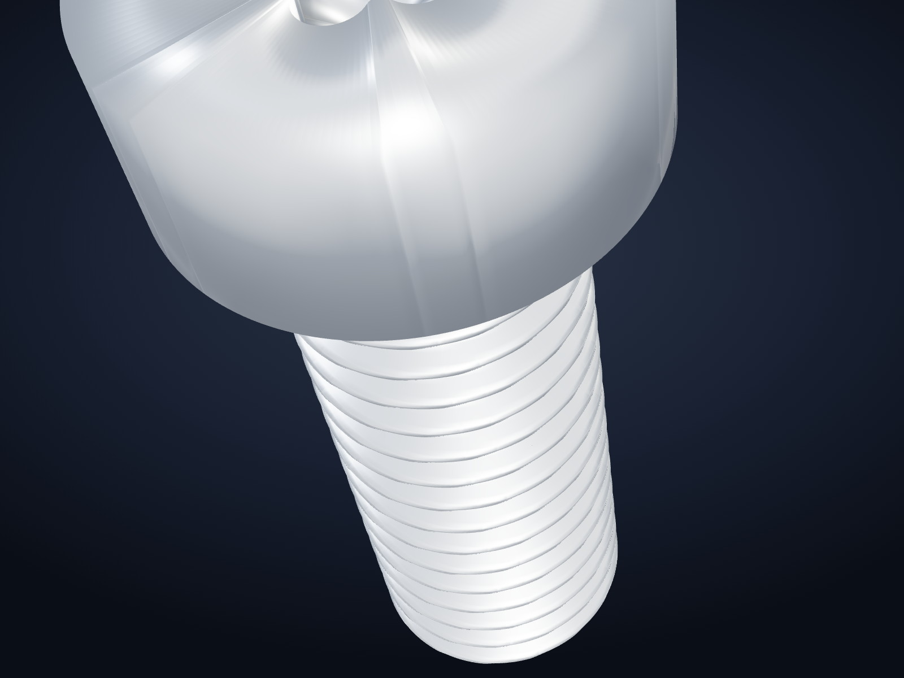 | M8 آلن · پَرهای کمانی مماس |
| **رزوهٔ ویتوورث** (۰٫۳٫۰) | 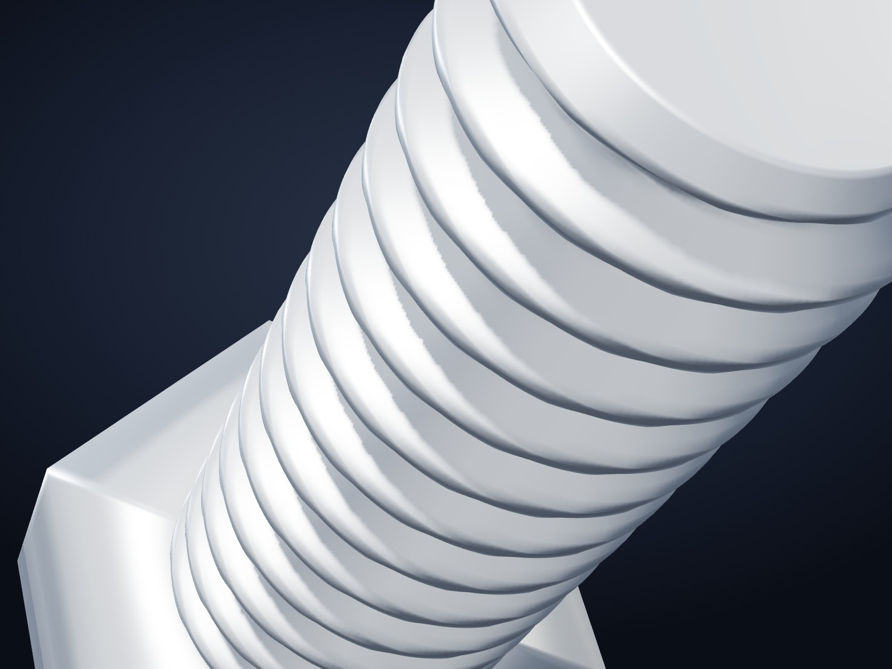 | ۱/۴-۲۰ BSW · پروفیل ۵۵° |
| **رزوهٔ مخروطی NPT** (۰٫۳٫۰) | 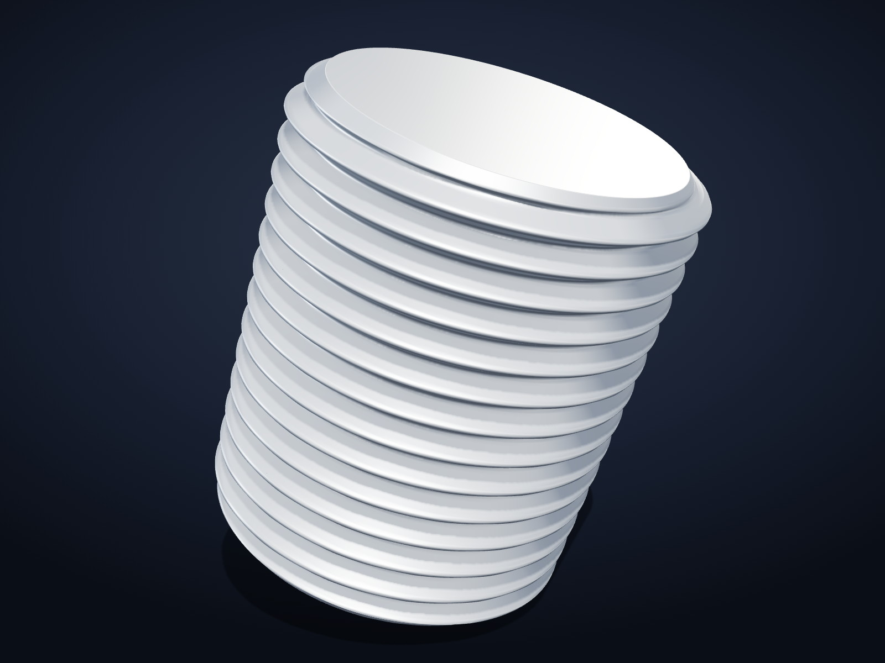 | ۱/۲-۱۴ NPT · مخروط ۱:۱۶ |
| **ذوزنقه‌ای Tr** (۰٫۳٫۰) |  | Tr20×4 · نیم‌زاویهٔ ۳۰° |

### 🆕 ویژگی‌های جدید ۰٫۴٫۰ — رندر مش‌های واقعی

| ویژگی | تصویر | مشخصات |
|---|---|---|
| **سر دکمه‌ای (Button)** | 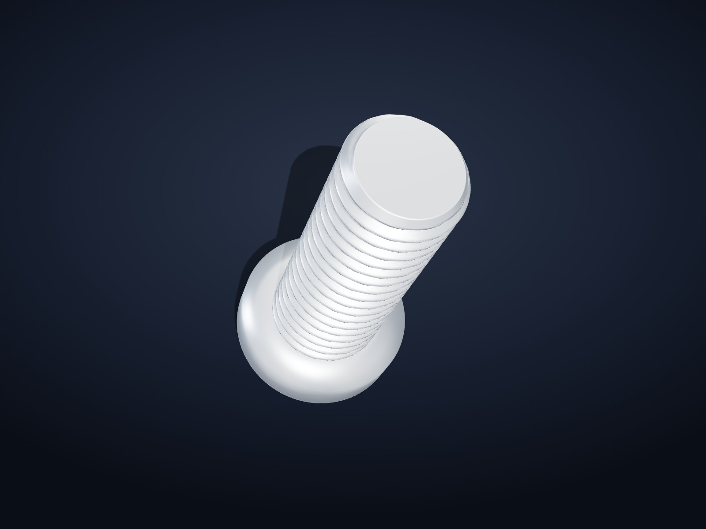 | M8×۲۲ · گنبد سهمی کم‌انحنا با حفرهٔ آلن روی پلتفرم قله |
| ماکروی سر دکمه‌ای | 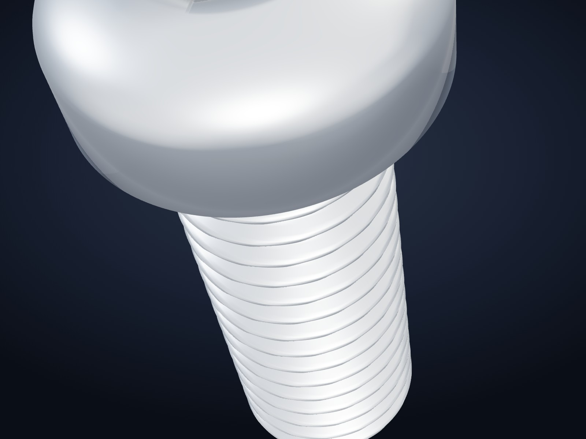 | حفرهٔ آلن شش‌گوش روی گنبد — نمای از بالا |
| **سر فلنجی (Flange)** |  | M8×۲۲ · دیسک فلنج + شش‌گوش با پخ فوقانی |
| **تورکس امنیتی (پین‌دار)** | 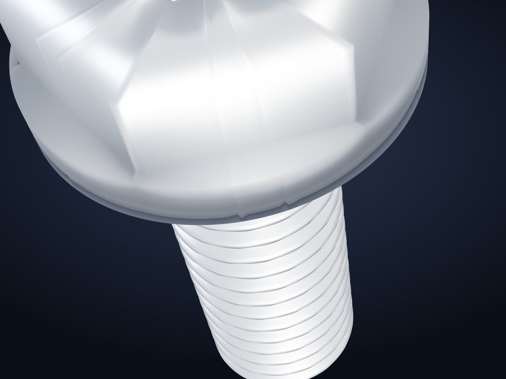 | حفرهٔ شش‌پر + **پین مرکزی** — آچار معمولی قفل می‌شود |
| **آلن امنیتی (PinHex)** | 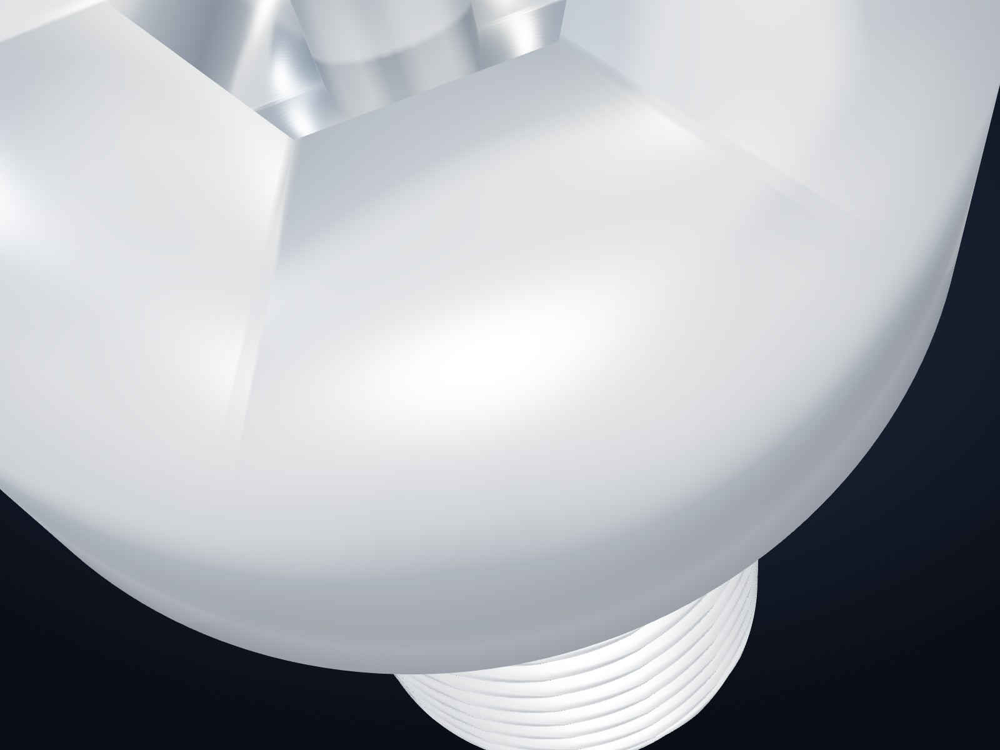 | M10 · حفرهٔ شش‌گوش + پین مرکزی (بازبینی ۱۰/۱۰) |
| تورکس امنیتی | 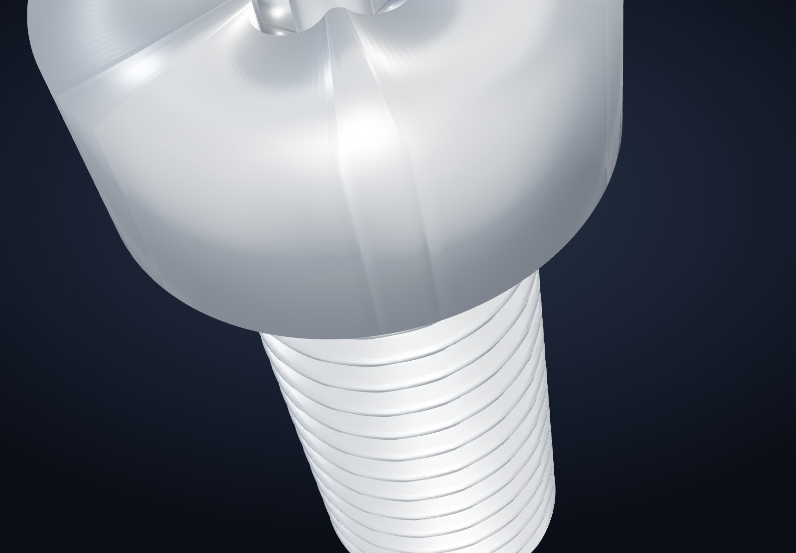 | M10 · حفرهٔ شش‌پر با پین |

#### 🧊 مقایسهٔ کیفیت مش — «دقیق» در برابر «حدی» (همان پیچ، همان زاویه)

<table><tr>
<th>دقیق (Fine) — ۱۹۲ بخش زاویه‌ای</th>
<th>حدی (Extreme) — ۷۶۸ بخش + ریزترین گام</th>
</tr><tr>
<td></td>
<td>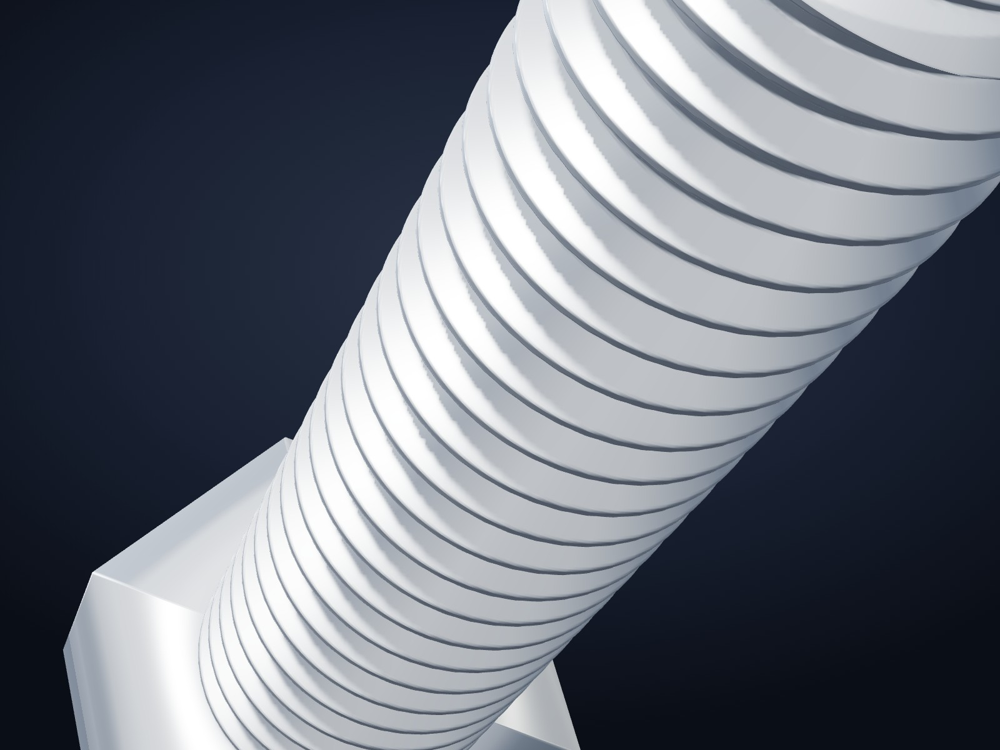</td>
</tr><tr>
<td align="center"><sub>لبه‌های رزوه پله‌ای/faceted — ۹۰٬۸۵۰ وجه</sub></td>
<td align="center"><sub><b>رزوهٔ کاملاً نرم و پیوسته</b> — ۱٬۱۴۶٬۵۲۸ وجه (۱۳ برابر)</sub></td>
</tr></table>

> هر دو فایل با یک دستور CLI و فقط تغییر `--quality fine` به `--quality extreme` ساخته شده‌اند؛ اندازهٔ OBJ از ۴٫۷MB به ۶۲٫۶MB رسید — «مش‌های خیلی زیاد و قطعهٔ خیلی نرم‌تر» دقیقاً همین‌جاست.

### 🧵 رندرهای پایه — تولیدشده با خود نرم‌افزار

<p align="center">
  
</p>

<p align="center"><sub>🔬 نمای نزدیک رزوهٔ مارپیچ M6 با کیفیت VeryFine — عمق/زاویهٔ پروفیل ۶۰°، ریشه و نوک گردشده</sub></p>

### 🪟 رابط کاربری فارسی راست‌چین — هر هفت صفحه (۰٫۴٫۰)

تصاویر این بخش، **بازتولید وفادار از قالب‌های XAML واقعی برنامهٔ ۰٫۴٫۰** است (همان تم بازطراحی‌شده، پالت رنگ، فونت وزیرمتن، آیکون رسمی بزرگ‌شده و متن‌های واقعی)؛ زیرا توسعه روی Linux انجام شده و پنجرهٔ WPF در آن اجرا نمی‌شود. در نمای سه‌بعدی، **مش واقعی** پیچ M8 فلنجی با تورکس امنیتی و پین (تولیدشده با خود CLI) با رندر استودیویی بارگذاری شده است.

| صفحه | تصویر |
|---|---|
| 🏠 خانه — شروع سریع و نمونه‌های جدید | 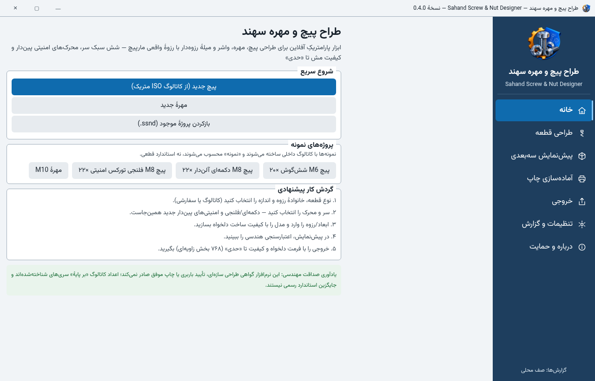 |
| 📐 طراحی قطعه — **سرهای دکمه‌ای/فلنجی + محرک‌های امنیتی + کیفیت ساخت** (۰٫۴٫۰) | 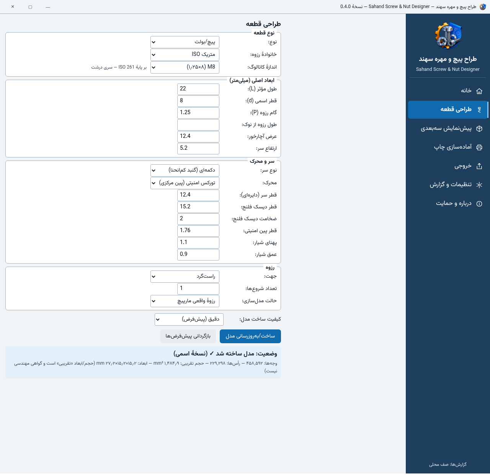 |
| 🧊 پیش‌نمایش سه‌بعدی — پیچ فلنجی تورکس امنیتی (مش واقعی) | 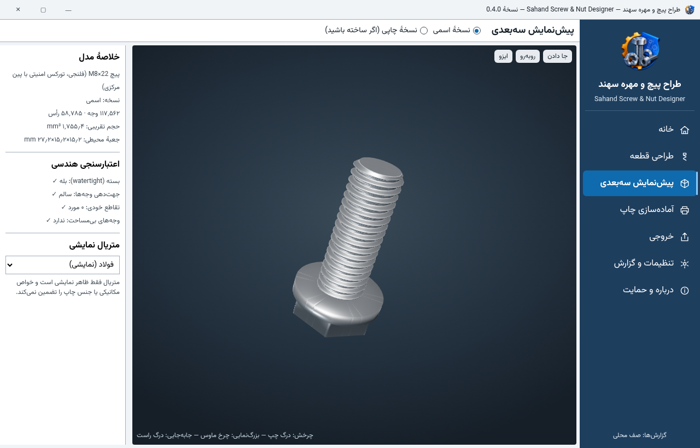 |
| 🖨️ آماده‌سازی چاپ — پروفایل فرایند + جدول تفاوت | 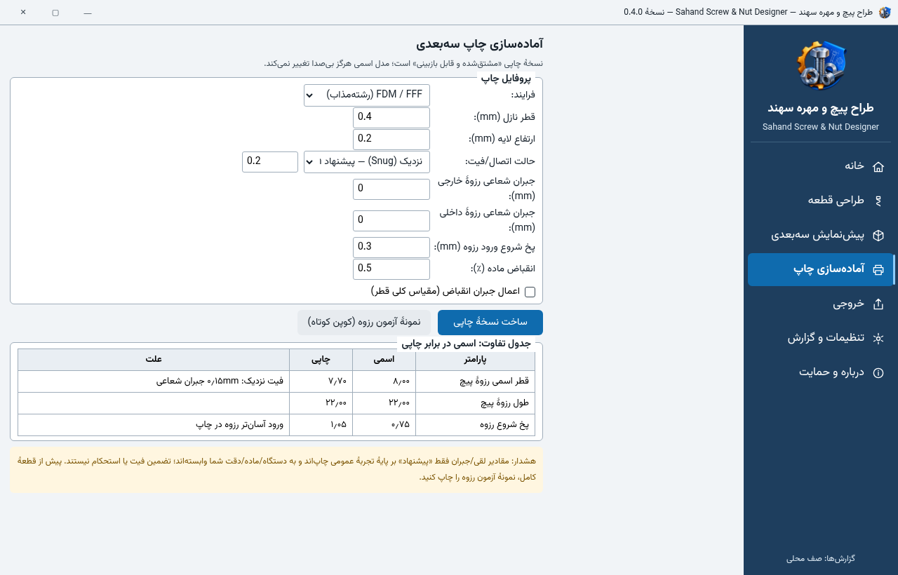 |
| 📤 خروجی — **شش سطح کیفیت تا «حدی» + بازسازی واقعی** | 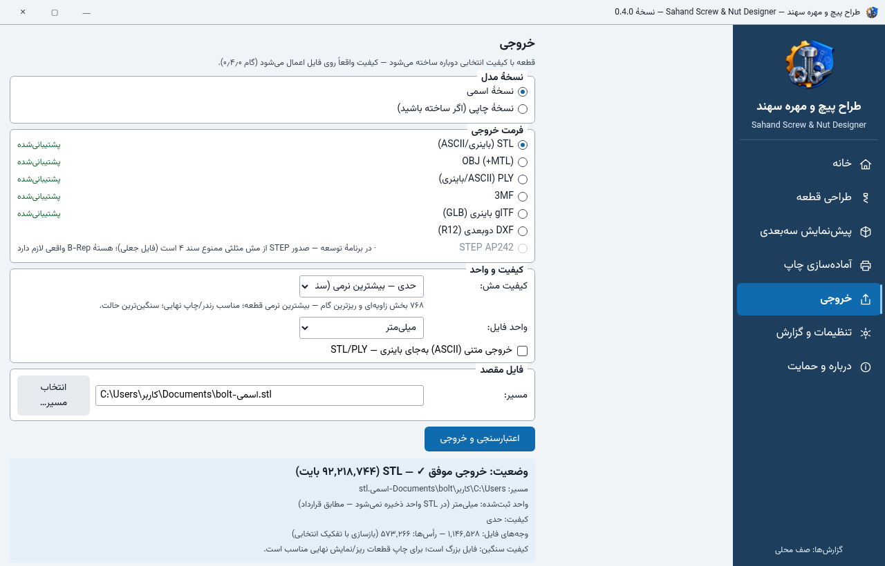 |
| ⚙️ تنظیمات و گزارش — صف محلی، SMTP، DPAPI | 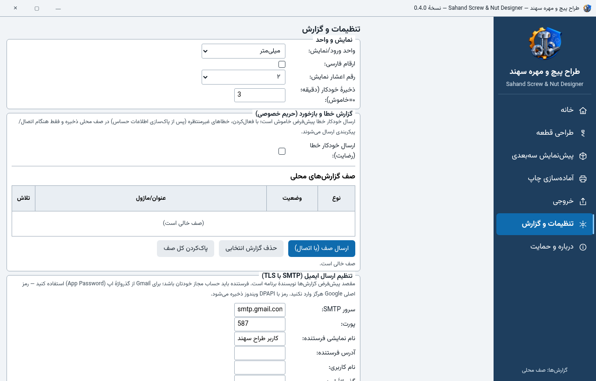 |
| ℹ️ درباره و حمایت — شناسنامهٔ ۰٫۴٫۰ و کارت پوشیده | 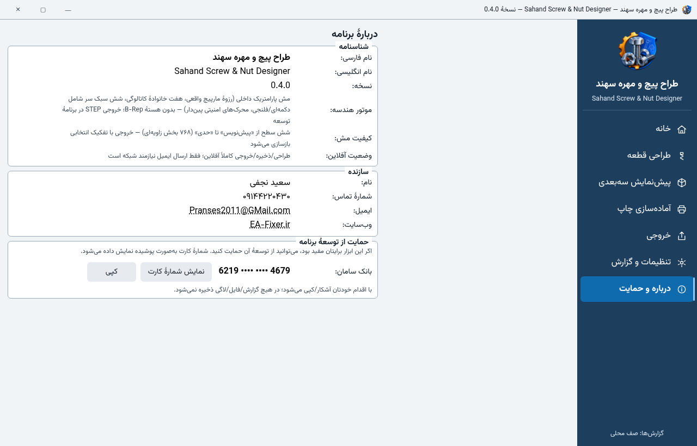 |

<details>
<summary>🖼️ پیش‌نمایش‌های نسخهٔ ۰٫۳٫۰ (برای مرور)</summary>

| صفحه | تصویر |
|---|---|
| خانه |  |
| طراحی |  |
| پیش‌نمایش |  |
| چاپ |  |
| خروجی |  |
| تنظیمات |  |
| درباره |  |

</details>

---

## 🚀 شروع سریع

### 🖱️ برنامهٔ روان (ویندوز)

1. بستهٔ نصب یا پرتابل را از [رلیزها](https://github.com/pranses2011/Sahand_Screw_Maker/releases) بگیرید — نیازی به نصب .NET نیست.
2. از «خانه» یک **پیچ جدید از کاتالوگ** بسازید یا نمونهٔ آماده را باز کنید.
3. **خانوادهٔ رزوه** (متریک/اینچی/ویتوورث/NPT/BSPP/ذوزنقه‌ای/ACME) و اندازه را انتخاب کنید؛ یادداشت منبع همان‌جا نمایش داده می‌شود.
4. ابعاد/رزوه را تنظیم و مدل را بسازید؛ **اعتبارسنجی هندسی** همان لحظه نتیجه را می‌گوید.
5. در صورت نیاز **نسخهٔ چاپی** با جبران‌ها مشتق کنید و **جدول تفاوت** را ببینید.
6. از بخش «خروجی» با فرمت و کیفیت دلخواه، فایل بگیرید.

### ⌨️ ابزار خط فرمان (ویندوز و لینوکس)

```bash
# ساخت پیچ شش‌گوش M6×20 با خروجی STL
ssnd-cli generate --part bolt --size M6 --length 20 --head Hex --export STL --out bolt.ssnd

# سرهای جدید ۰٫۴٫۰: دکمه‌ای آلن‌دار و فلنجی تورکس امنیتی با پین
ssnd-cli generate --part bolt --size M8 --head Button --drive HexSocket --length 22 --export STL --out button.ssnd
ssnd-cli generate --part bolt --size M8 --head Flange --drive SecurityTorx --pin-diameter 1.8 --length 22 --export STL --out flange.ssnd

# محرک امنیتی آلن با پین + کنترل قطر پین
ssnd-cli generate --part bolt --size M10 --head SocketCap --drive PinHex --pin-diameter 2.2 --export OBJ --out pinhex.ssnd

# کیفیت‌های خیلی عالی ۰٫۴٫۰ — مش‌های خیلی زیاد و قطعهٔ نرم‌تر
ssnd-cli generate --part bolt --size M8 --length 30 --quality ultra --export STL --out smooth-ultra.ssnd
ssnd-cli generate --part bolt --size M8 --length 30 --quality extreme --export STL --out smooth-extreme.ssnd   # ۵٫۷ میلیون وجه!

# پیچ آلن با حفرهٔ تورکس (۰٫۳٫۰)
ssnd-cli generate --part bolt --size M8 --head SocketCap --drive Torx --length 22 --export STL --out torx.ssnd

# پیچ ویتوورث و میل NPT مخروطی و ذوزنقه‌ای (خانواده‌های ۰٫۳٫۰)
ssnd-cli generate --part bolt --size "1/4-20 BSW" --head Hex --length 16 --export OBJ --out bsw.ssnd
ssnd-cli generate --part rod --size "1/2-14 NPT" --length 26 --export STL --out npt.ssnd
ssnd-cli generate --part rod --size "Tr20×4" --length 28 --export OBJ --out tr.ssnd

# مهرهٔ M8 با رزوهٔ داخلی واقعی + خروجی 3MF
ssnd-cli generate --part nut --size M8 --export 3MF --out nut.ssnd

# مجموعهٔ جفت با واشر
ssnd-cli generate --part assembly --size M6 --length 20 --washer --export OBJ --out asm.ssnd

# کوپن آزمون رزوه (۴ گام) برای تنظیم فیت پیش از چاپ کامل
ssnd-cli coupon --size M6 --export STL --out coupon.ssnd

# فهرست کاتالوگ هر خانواده و اعتبارسنجی پروژه
ssnd-cli catalog --family bsw
ssnd-cli catalog --family npt
ssnd-cli validate --in bolt.ssnd
```

خروجی واقعی اجرا روی لینوکس (پیام‌های واقعی برنامه):

```text
ذخیره شد: flange.ssnd
خروجی STL: 92218744 بایت
اعتبارسنجی مش: watertight=True, جهت‌دهی=True
```

### 🔨 ساخت از سورس

```bash
git clone https://github.com/pranses2011/Sahand_Screw_Maker.git
cd Sahand_Screw_Maker
dotnet build SahandScrewMaker.sln        # بیلد ۱۱ پروژه — ۰ خطا/۰ هشدار
dotnet test SahandScrewMaker.sln          # ۱۸۰ آزمون
dotnet publish src/Sahand.App/Sahand.App.csproj -c Release -r win-x64 --self-contained true -o publish/app-win
```

راهنمای کامل و بستهٔ ویندوز: [docs/BUILD-FA.md](docs/BUILD-FA.md)

---

## 🧰 قابلیت‌ها

| | قابلیت | جزئیات |
|---|---|---|
| 🧵 | **رزوهٔ واقعی مارپیچ** | **۷ خانوادهٔ کاتالوگی: ISO متریک درشت/ریز، UNC/UNF، ویتوورث BSW/BSF، NPT مخروطی (۱:۱۶)، BSPP، ذوزنقه‌ای Tr، ACME** + پروفیل سفارشی، چندشروع (`lead = pitch × starts`)، چپ‌گرد، مخروط دلخواه — با ساخت watertight، نه پس‌پردازش |
| 🔩 | **قطعات** | پیچ (**شش‌گوش/آلن/خزینه/نیم‌گرد/دکمه‌ای/فلنجی**)، مهرهٔ شش‌گوش/جام با رزوهٔ داخلی، واشر، میل رزوه‌دار، **مجموعهٔ جفت با سازگارسنجی** |
| ⚙️ | **محرک‌ها** | **حفرهٔ تورکس شش‌پر (کمان‌های مماس)**، حفرهٔ آلن، **آلن امنیتی (PinHex) و تورکس امنیتی (SecurityTorx) با پین مرکزی**، شیار تخت، شیار صلیبی فیلیپس — روی سرهای مجاز |
| 🧊 | **کیفیت مش شش‌سطحی** | از «پیش‌نویس» (۴۸ بخش) تا **«حدی» (۷۶۸ بخش + ریزترین گام)** — کیفیت انتخابی خروجی **واقعاً اعمال می‌شود** (بازسازی از سند) |
| 🖼️ | **پیش‌نمایش استودیویی** | سایه‌روشن هموارِ آگاه از لبه + متریال فلزی Specular + نور سه‌نقطه‌ای + پس‌زمینهٔ گرادیانی + سایهٔ نرم زمین + انتخاب کیفیت ساخت |
| 🧮 | **ورود مهندسی** | ارقام فارسی/لاتین، کسر اینچ (مثل `1/4-20`)، تبدیل دقیق mm↔inch بدون گردکردن بی‌صدا |
| 🖨️ | **نسخهٔ چاپی** | مشتق بدون دست‌زدن به نسخهٔ اسمی، جبران‌های FDM/SLA/SLS، جدول تفاوت + کوپن آزمون |
| 📤 | **خروجی‌ها** | STL باینری/ASCII، OBJ، PLY، 3MF، GLB، DXF دوبعدی — با آزمون رفت‌وبرگشت از خوانندهٔ مستقل |
| 📊 | **اطلاعات مهندسی** | حجم/جرم تقریبی (قضیهٔ گردش)، bbox، شمارش وجه/رأس — با برچسب «تقریبی» |
| ✅ | **اعتبارسنجی صادقانه** | رد ورودی نامعتبر با پیام فارسیِ قابل‌اقدام؛ ممنوعیت «موفق» کاذب در CLI و UI |
| 📧 | **گزارش و ایمیل آگاهانه** | صف محلی آفلاین، redaction راز/کارت/مسیر، SMTP خام با STARTTLS اجباری، DPAPI |
| ↩️ | **Undo/Redo** | زیرساخت پشتهٔ فرمان + بازیابی خودکار پس از crash |
| 🌐 | **کاملاً آفلاین** | طراحی/ذخیره/خروجی بدون اینترنت؛ ایمیل فقط با رضایت و تنظیم صریح کاربر |

#### 🧊 سطوح کیفیت مش (۰٫۴٫۰)

| سطح | بخش زاویه‌ای | گام مارپیچ | کاربرد |
|---|---|---|---|
| پیش‌نویس | ۴۸ | گام/۶ | بازبینی سریع |
| متعادل | ۹۶ | گام/۱۰ | کار روزمره |
| دقیق (پیش‌فرض) | ۱۹۲ | گام/۱۶ | چاپ معمول — پیش‌فرض ساخت و خروجی |
| بسیار دقیق | ۳۲۰ | گام/۲۴ | قطعات ریز |
| **فوق‌دقیق** (۰٫۴٫۰) | ۵۱۲ | گام/۳۶ | نرمی عالی — چاپ دقیق/رندر |
| **حدی** (۰٫۴٫۰) | ۷۶۸ | گام/۴۸ | **بیشترین نرمی قطعه** — نمونهٔ واقعی: M8×30 با ۵٫۷ میلیون وجه |

### 📇 کاتالوگ رزوه‌ها — هفت خانوادهٔ کاتالوگی

| خانواده | پروفیل | سری‌ها | نمونه |
|---|---|---|---|
| ISO متریک | ۶۰° | درشت + ریز | M1 … M48 |
| یونیفاید اینچی | ۶۰° | UNC + **UNF** | #0-80 … 1-1/2-12 |
| ویتوورث | ۵۵° | BSW + **BSF** | 1/8-40 … 3-3.5 |
| NPT لوله‌ای | ۶۰° + مخروط ۱:۱۶ | NPT | 1/16-27 … 6-8 |
| BSP لوله‌ای | ۵۵° موازی | BSPP (G) | G1/16-28 … G2-11 |
| ذوزنقه‌ای ISO | نیم‌زاویهٔ ۳۰° | Tr | Tr8×1.5 … Tr48×8 |
| ACME | نیم‌زاویهٔ ۱۴٫۵° | عمومی | 1/4-16 … 3-2 |

> داده‌ها «بر پایهٔ» سری‌های شناخته‌شدهٔ مهندسی‌اند (ISO 261، ASME B1.1، ISO 262/BS 84، ASME B1.20.1، ISO 228، ISO 2901، ASME B1.5)؛ یادداشت منبع هر مدخل در UI و فایل پروژه حمل می‌شود و ادعای انطباق رسمی مطرح نمی‌شود.

---

## 📊 فرمت‌های خروجی — ماتریس صادقانه

| فرمت | وضعیت | یادداشت |
|---|---|---|
| STL (باینری/ASCII) | ✅ پایدار | آزمون رفت‌وبرگشت با خوانندهٔ مستقل |
| OBJ (+MTL) | ✅ پایدار | واحدها در نام/گزارش ثبت می‌شود |
| PLY | ✅ پایدار | — |
| 3MF | ✅ پایدار | آزمون رفت‌وبرگشت + تفاوت واقعی presetهای کیفیت |
| GLB | ✅ پایدار | — |
| DXF (R12) | ✅ پایدار | پروفیل دوبعدی رزوه/نمای جانبی — جدا از فهرست سه‌بعدی |
| STEP AP242 | 🕒 برنامهٔ توسعه | نیازمند هستهٔ B-Rep؛ **تولید STEP جعلی از مش صریحاً رد می‌شود** |

---

## 🧪 کیفیت

| | |
|---|---|
| بیلد (۱۱ پروژه) | ✅ **۰ خطا · ۰ هشدار** |
| آزمون‌ها | ✅ **۱۸۰/۱۸۰ سبز** — دامنه ۶۴ · هندسه ۷۱ (شامل ۱۱ آزمون کیفیت جدید + ۱۸ آزمون سر دکمه‌ای/فلنجی/امنیتی) · خروجی‌گیرها ۱۶ · گزارش ۱۹ · یکپارچگی CLI ۱۰ |
| watertight | ✅ همهٔ ترکیب‌های مجاز سر/محرک (شامل دکمه‌ای/فلنجی/پین‌دار) + خانواده‌های رزوه در آزمون‌ها |
| ریاضی تورکس | ✅ راستی‌آزمایی عددی مستقل — مماس‌بودن کمان‌ها با خطای ۱e-16 |
| کیفیت‌های سنگین | ✅ Ultra/Extreme با آزمون رشد وجه Fine<Ultra<Extreme + watertight |
| امنیت `.ssnd` | ✅ دفاع ZIP-bomb و مسیر-traversal |

```bash
dotnet test SahandScrewMaker.sln   # اجرای کامل ۱۸۰ آزمون
```

گزارش کامل پوشش ماتریس پذیرش: [docs/TEST-REPORT-FA.md](docs/TEST-REPORT-FA.md)

---

## 🔒 آفلاین و حریم خصوصی

- 🚫 **بدون تله‌متری، بدون ارسال داده، بدون دانلود زمانِ اجرا** — همهٔ مسیرهای طراحی/ذخیره/خروجی آفلاین‌اند.
- 📧 ایمیل خطا/بازخورد فقط با **رضایت صریح + پیکربندی + اتصال** ارسال می‌شود؛ در حالت آفلاین در **صف محلی** می‌ماند.
- 🧹 Redaction خودکار راز/شمارهٔ کارت/مسیر/IP در متن گزارش‌ها.
- 🔑 رمز SMTP با **DPAPI** ویندوز ذخیره می‌شود (پشت اینترفیس، جدا از منطق).
- 💳 شمارهٔ کارت حمایت در صفحهٔ «درباره» به‌صورت **پوشیده** نمایش داده می‌شود؛ آشکارسازی/کپی با اقدام آگاهانهٔ کاربر است.

جزئیات: [docs/PRIVACY-FA.md](docs/PRIVACY-FA.md)

---

## 🗂️ ساختار مخزن

```text
Sahand_Screw_Maker/
├── src/
│   ├── Sahand.Core/        # دامنه: رزوه (۷ خانواده)، قطعات، واحد، اعتبارسنجی، کاتالوگ، .ssnd
│   ├── Sahand.Geometry/    # موتور مش: جاروب مارپیچ، تورکس، سازنده‌ها، watertight
│   ├── Sahand.Exporters/   # STL/OBJ/PLY/3MF/GLB/DXF + خوانندهٔ round-trip
│   ├── Sahand.Reporting/   # صف گزارش، redaction، SMTP خام امن
│   ├── Sahand.Cli/         # ssnd-cli — اتوماسیون بدون رابط
│   └── Sahand.App/         # WPF فارسی RTL + وزیرمتن (OFL) + آیکون رسمی
├── tests/                  # ۵ پروژهٔ xUnit — ۱۸۰ آزمون
├── samples/                # ۴ پروژهٔ نمونهٔ .ssnd
├── installer/              # اسکریپت NSIS نصب‌کنندهٔ فارسی
├── docs/                   # مستندات فارسی + assets (رندرها/UI)
├── prompts/                # اسناد مشخصات اولیهٔ پروژه
└── analysis/               # تحلیل عامل پیش از پیاده‌سازی
```

---

## 🗺️ نقشهٔ راه

- [x] هستهٔ پارامتریک + رزوهٔ مارپیچ واقعی
- [x] ۶ فرمت خروجی + آزمون رفت‌وبرگشت
- [x] نسخهٔ چاپی + کوپن آزمون + CLI
- [x] رلیز آفلاین ویندوز (۰٫۱٫۰) + رفع کرش‌ها و رصد خطای سراسری (۰٫۲٫۰)
- [x] **کاتالوگ کامل‌تر: Whitworth، NPT، BSPP، ACME (+UNF و Tr)** (۰٫۳٫۰)
- [x] **Torx** (۰٫۳٫۰)
- [x] **کیفیت‌های خیلی عالی خروجی (فوق‌دقیق/حدی) با اعمال واقعی روی فایل** (۰٫۴٫۰)
- [x] **سرهای خاص: دکمه‌ای و فلنجی** (۰٫۴٫۰)
- [x] **محرک‌های امنیتی پین‌دار: آلن امنیتی و تورکس امنیتی** (۰٫۴٫۰)
- [ ] محرک‌های امنیتی دیگر (تک‌جهته OneWay و دو-حفره‌ای Spanner) — برنامهٔ توسعه
- [ ] تأیید بصری ویندوز توسط کارفرما
- [ ] STEP AP242 با هستهٔ B-Rep

---

## 📚 مستندات

| سند | موضوع |
|---|---|
| [راهنمای کاربر](docs/USER-GUIDE-FA.md) | گردش‌کار طراحی، رزوه، خروجی، چاپ، ایمیل و عیب‌یابی |
| [راهنمای ساخت](docs/BUILD-FA.md) | ساختار راه‌حل، وابستگی‌ها، publish ویندوز |
| [تاریخچهٔ تغییرات](docs/CHANGELOG-FA.md) | تغییرات نسخه‌ها (۰٫۱٫۰ تا ۰٫۴٫۰) |
| [گزارش بازبینی ۰٫۲٫۰](analysis/01-AUDIT-AND-IMPROVEMENTS-FA.md) | ریشه‌یابی کرش‌ها، فهرست نواقص و برنامهٔ بهبود |
| [راهنمای توسعه‌دهنده](docs/DEVELOPER-FA.md) | معماری لایه‌ای، مدل ریاضی رزوه، قانون کامنت |
| [ماتریس فرمت‌ها](docs/FORMATS-AND-STATUS-FA.md) | وضعیت صادقانهٔ هر فرمت خروجی |
| [گزارش آزمون](docs/TEST-REPORT-FA.md) | ماتریس پذیرش، پوشش آزمون‌ها، محدودیت‌ها |
| [حریم خصوصی](docs/PRIVACY-FA.md) | رضایت، پاک‌سازی، DPAPI و کارت پوشیده |
| [پرامپت مادر](PROMPT.md) | اسناد مشخصات اولیهٔ پروژه (منبع الزامات) |

---

## ⚠️ محدودیت‌های صادقانهٔ نسخهٔ ۰٫۴٫۰

- **اجرای بصری WPF** (به‌ویژه ظاهر رندر پیش‌نمایش و تم بازطراحی‌شده) روی ویندوز واقعی باید تأیید شود (توسعه روی Linux، بیلد سبز؛ تصاویر رابط، بازتولید وفادار قالب‌های XAML‌اند). در صورت مشاهدهٔ خطای جدید، فایل `crash-log.txt` (پوشهٔ دادهٔ برنامه) اثر ماندگار دارد.
- **نصب‌کنندهٔ NSIS** روی Linux کامپایل شده؛ فرایند نصب روی ویندوز باید آزموده شود.
- دادهٔ کاتالوگ «بر پایهٔ» سری‌های شناخته‌شدهٔ مهندسی است (ادعای انطباق رسمی مطرح نمی‌شود)؛ خانواده‌های **مربعی و سفارشی** پروفیل بدون کاتالوگ دارند.
- **NPT** هندسهٔ مخروطی واقعی دارد اما «آب‌بندی» لوله‌ای (مهرهٔ مخروطی/درزچسب) از دامنهٔ نرم‌افزار خارج است.
- شیار روی سر شش‌گوش/خزینه/دکمه‌ای (گنبد) و محرک‌های امنیتی **تک‌جهته (OneWay) و دو-حفره‌ای (Spanner)** در برنامهٔ توسعه‌اند و در اعتبارسنجی صادقانه رد می‌شوند — هندسهٔ رمپ مورب/حفره‌های زوج واقعی نیاز دارد و تولید تقریبی جایگزین نمی‌شود.
- برای مش‌های بزرگ‌تر از ۲۵۰٬۰۰۰ وجه (کیفیت فوق‌دقیق/حدی) بررسی **تقاطع خودی** با پیام صادقانه «انجام نشد» رد می‌شود (هزینهٔ محاسباتی)؛ watertight/جهت‌دهی کامل بررسی می‌شوند.
- **STEP AP242** عمداً در برنامهٔ توسعه است: صدور STEP از مش مثلثی ممنوعِ سند ۴ است (فایل جعلی) و هستهٔ B-Rep واقعی نیاز دارد.
- تقاطع خودی مش «هیوریستیکی» است (کشف قطعی تضمین‌نشده) — در کد مستند شده.

---

## 📜 مجوز و سپاس

- **کد:** مالک کارفرما — [LICENSE](LICENSE)
- **فونت وزیرمتن** نسخهٔ ۳۳٫۰۰۳ اثر [راستی‌کردار](https://github.com/rastikerdar/vazirmatn) با مجوز [OFL](src/Sahand.App/Fonts/OFL-Vazirmatn.txt) — استاتیک همراه بسته، بدون نیاز به نصب
- **آیکون رسمی برنامه** (`docs/assets/ScrewIcon.png`) اثر کارفرما — پیچ و مهره و چرخ‌دنده بر بوم نقشهٔ فنی
- این پروژه از یک «بستهٔ پرامپت توسعه» آغاز شد؛ اسناد الزامات در [PROMPT.md](PROMPT.md) و تحلیل پیش از پیاده‌سازی در [analysis/00-AGENT-ANALYSIS.md](analysis/00-AGENT-ANALYSIS.md) موجود است.

</div>
