<p align="center">
  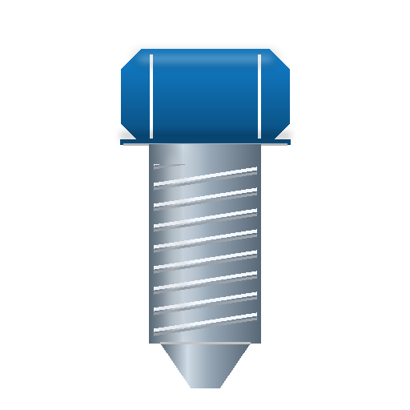
</p>

<h1 align="center">طراح پیچ و مهره سهند</h1>

<p align="center">
  <strong><em>Sahand Screw &amp; Nut Designer</em></strong><br>
  طراحی پارامتریک پیچ، مهره، واشر و میل رزوه‌دار — کاملاً فارسی، راست‌چین و آفلاین
</p>

<p align="center">
  <a href="https://github.com/pranses2011/Sahand_Screw_Maker/releases/tag/v0.2.0"></a>
  <a href="https://github.com/pranses2011/Sahand_Screw_Maker/releases/tag/v0.2.0"></a>
  
  
  
  
  
</p>

<p align="center">
  ⬇️ <a href="https://github.com/pranses2011/Sahand_Screw_Maker/releases/tag/v0.2.0"><strong>دانلود نسخهٔ ۰٫۲٫۰ — بستهٔ آفلاین ویندوز (رفع کرش‌های بحرانی)</strong></a>
</p>

<hr>

<div dir="rtl">

## ✨ معرفی

**«طراح پیچ و مهره سهند»** یک نرم‌افزار دسکتاپ مهندسی برای طراحی **پارامتریک** پیچ، مهره، واشر و میلهٔ رزوه‌دار با **رزوهٔ واقعی مارپیچ** (نه نمایشی) است؛ خروجی‌های آمادهٔ اسلایسر، نسخهٔ چاپی با جبران قابل تنظیم و ابزار خط فرمان برای اتوماسیون — همه **بدون اینترنت، بدون تله‌متری و بدون وابستگی زمانِ اجرا**.

### 🆕 تازه‌های نسخهٔ ۰٫۲٫۰

| | تغییر |
|---|---|
| 🛠️ | **رفع کرش صفحهٔ «طراحی قطعه»** (گزارش‌شده روی ویندوز): ریشهٔ خطا با بازبینی کامل شناسایی و رفع شد — رخداد زودهنگام XAML هنگام بارگذاری نما |
| 🛠️ | **رفع کرش صفحهٔ «پیش‌نمایش سه‌بعدی»** با همان الگو |
| 🛡️ | **رصد خطای سراسری**: خطاهای غیرمنتظره مهار می‌شوند، برنامه باز می‌ماند و اثر خطا در `logs/crash-log.txt` می‌ماند |
| 🧵 | **انتخاب خانوادهٔ رزوهٔ متریک ISO / اینچی UNC** از رابط طراحی (کاتالوگ ASME B1.1 در دسترس UI) |
| 🎨 | **آیکون رسمی برنامه** (`ScrewIcon`) برای EXE و پنجره + نمایش نسخه در عنوان پنجره |

جمع‌بندی کامل: [docs/CHANGELOG-FA.md](docs/CHANGELOG-FA.md) · ریشه‌یابی کامل کرش: [analysis/01-AUDIT-AND-IMPROVEMENTS-FA.md](analysis/01-AUDIT-AND-IMPROVEMENTS-FA.md)

<p align="center">
  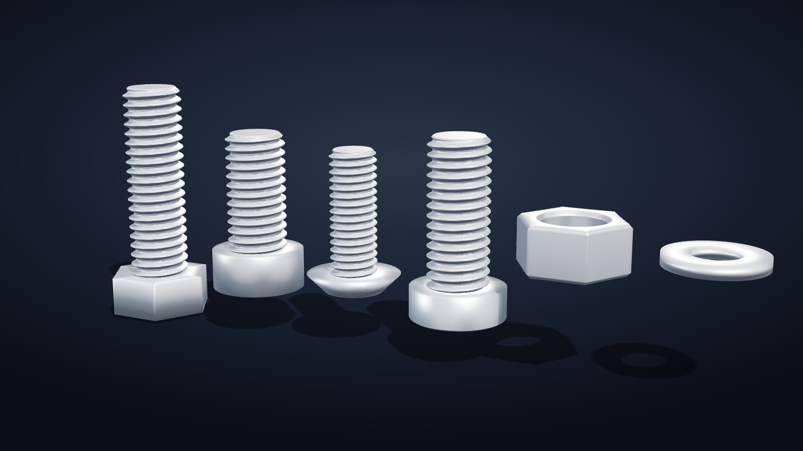
</p>

<p align="center"><sub>🏠 خانوادهٔ قطعات: پیچ شش‌گوش، آلن استوانه‌ای، خزینه، نیم‌گرد، مهرهٔ شش‌گوش و واشر — <b>رندر مستقیم مش‌های واقعی</b> تولیدشده با <code>ssnd-cli</code> (کیفیت Fine)</sub></p>

---

## 📦 دانلود و نصب (نسخهٔ ۰٫۲٫۰)

هر دو بستهٔ ویندوز **خودکفایند** — نیازی به نصب .NET یا اتصال اینترنت ندارند:

| بسته | کاربرد | اندازه |
|---|---|---|
| [`SahandScrewMaker-Setup-0.2.0.exe`](https://github.com/pranses2011/Sahand_Screw_Maker/releases/download/v0.2.0/SahandScrewMaker-Setup-0.2.0.exe) | نصب‌کننده با **رابط فارسی/راست‌چین** (NSIS)؛ میانبر، مستندات، نمونه‌ها و حذف‌کنندهٔ ویندوزی | ~۴۸ MB |
| [`SahandScrewMaker-0.2.0-win-x64-Portable.zip`](https://github.com/pranses2011/Sahand_Screw_Maker/releases/download/v0.2.0/SahandScrewMaker-0.2.0-win-x64-Portable.zip) | نسخهٔ پرتابل: استخراج و اجرا؛ برنامه + CLI + مستندات + نمونه‌ها | ~۹۹ MB |
| [`ssnd-cli-0.2.0-linux-x64.tar.gz`](https://github.com/pranses2011/Sahand_Screw_Maker/releases/download/v0.2.0/ssnd-cli-0.2.0-linux-x64.tar.gz) | ابزار خط فرمان لینوکس (روی همین محیط واقعاً اجرا و آزمون شد) | ~۳۱ MB |

> 🔐 جمع‌آزما (SHA-256) همهٔ بسته‌ها در [`SHA256SUMS.txt`](https://github.com/pranses2011/Sahand_Screw_Maker/releases/download/v0.2.0/SHA256SUMS.txt) پیوست رلیز است.
>
> 🛡️ **اگر از ۰٫۱٫۰ می‌آیید:** کرش هنگام کلیک روی «طراحی قطعه»/«پیش‌نمایش سه‌بعدی» در این نسخه رفع شده است — به‌روزرسانی به ۰٫۲٫۰ راجدارید.
>
> ⚠️ **صداقت مهندسی:** بیلد و آزمون خودکار روی Linux انجام شده (۱۱۳ آزمون سبز)؛ **اجرای بصری برنامهٔ WPF و فرایند نصب باید روی ویندوز واقعی توسط شما تأیید شود.**

---

## 🖼️ گالری

### 🧵 رندر مش‌های واقعی — تولیدشده با خود نرم‌افزار

همهٔ تصاویر زیر از **خروجی واقعی موتور هندسه** رندر شده‌اند: هر قطعه با ابزار `ssnd-cli` همین مخزن ساخته و سپس نمایش داده شده است — هیچ مدل دست‌ساز یا پول‌شده‌ای در کار نیست.

| قطعه | تصویر | مشخصات |
|---|---|---|
| پیچ شش‌گوش | 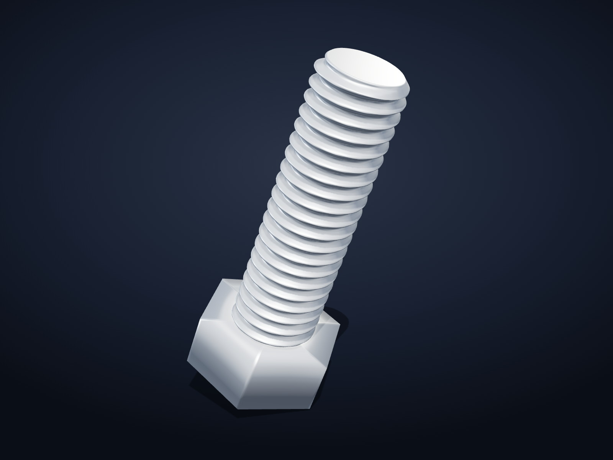 | M6×۲۰ · رزوهٔ ISO ۲۶۱ درشت · ۲۶٬۴۹۶ وجه |
| پیچ آلن |  | M8×۱۶ · استوانه‌ای با حفرهٔ آلن واقعی |
| پیچ خزینه |  | M6×۱۶ · سر مخروطی ۹۰° |
| پیچ نیم‌گرد |  | M5×۱۲ · سر گِردِ لبه‌خورده |
| مهرهٔ شش‌گوش | 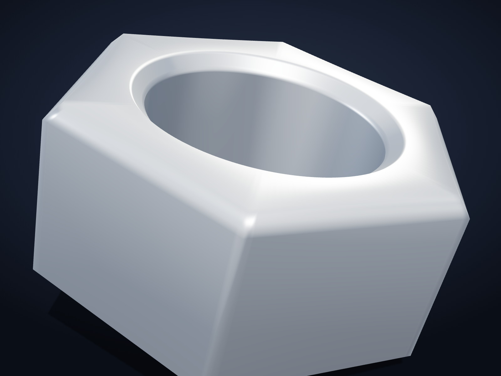 | M6 · **رزوهٔ داخلی واقعی** |
| واشر تخت |  | M6 · قطر داخلی ۶٫۶ |
| میل رزوه‌دار | 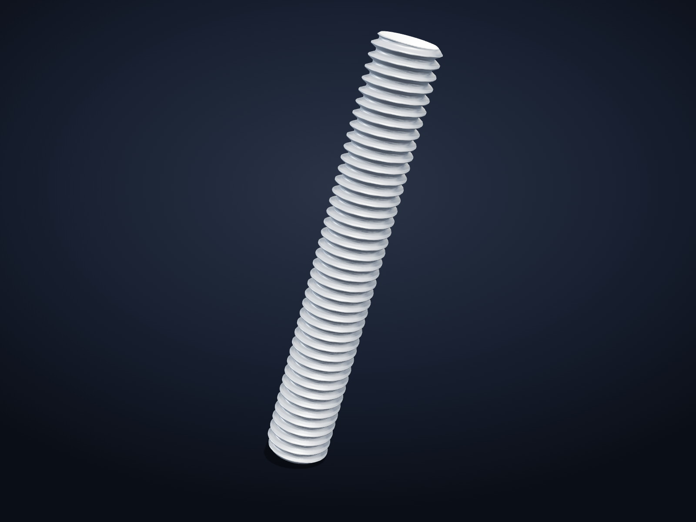 | M6×۴۰ · تمام‌رزوه |
| مجموعهٔ جفت | 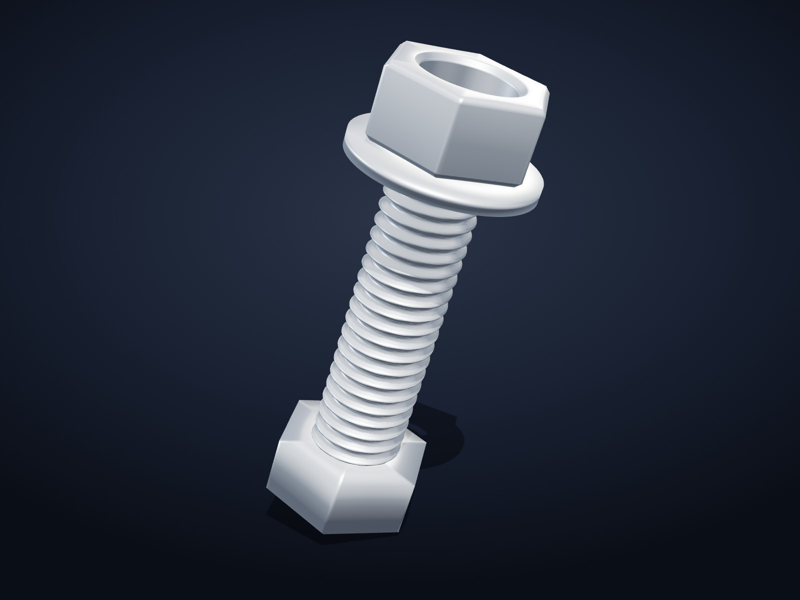 | پیچ + مهره + واشر M6 |
| کوپن آزمون |  | ۴ گام رزوه برای تنظیم فیت پیش از چاپ کامل |

<p align="center">
  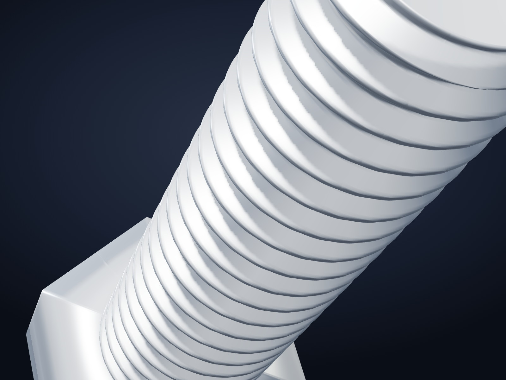
</p>

<p align="center"><sub>🔬 نمای نزدیک رزوهٔ مارپیچ M6 با کیفیت VeryFine — عمق/زاویهٔ پروفیل ۶۰°، ریشه و نوک گردشده</sub></p>

### 🪟 رابط کاربری فارسی راست‌چین — هر هفت صفحه

تصاویر این بخش، **بازتولید وفادار از قالب‌های XAML واقعی برنامهٔ ۰٫۲٫۰** است (همان تم، پالت رنگ، فونت وزیرمتن، آیکون‌ها و متن‌های واقعی)؛ زیرا توسعه روی Linux انجام شده و پنجرهٔ WPF در آن اجرا نمی‌شود. در نمای سه‌بعدی، **مش واقعی** پیچ M6 (۹۷٬۵۳۶ وجه، تولیدشده با خود CLI) بارگذاری شده است.

| صفحه | تصویر |
|---|---|
| 🏠 خانه — شروع سریع، نمونه‌ها و گردش‌کار | 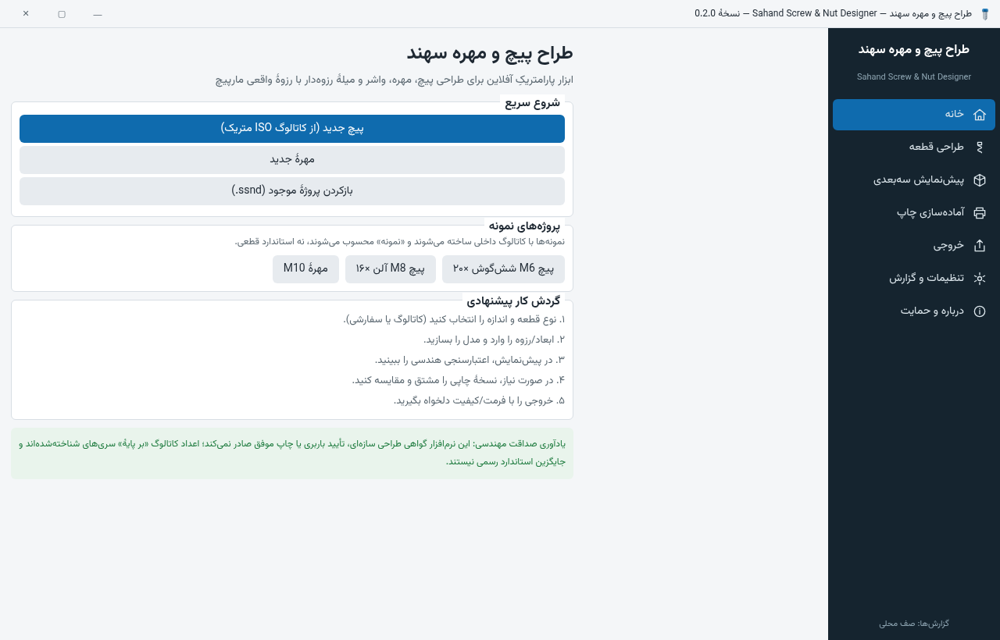 |
| 📐 طراحی قطعه — فرم پارامتریک با **خانوادهٔ رزوهٔ ISO/UNC** (جدید ۰٫۲٫۰) | 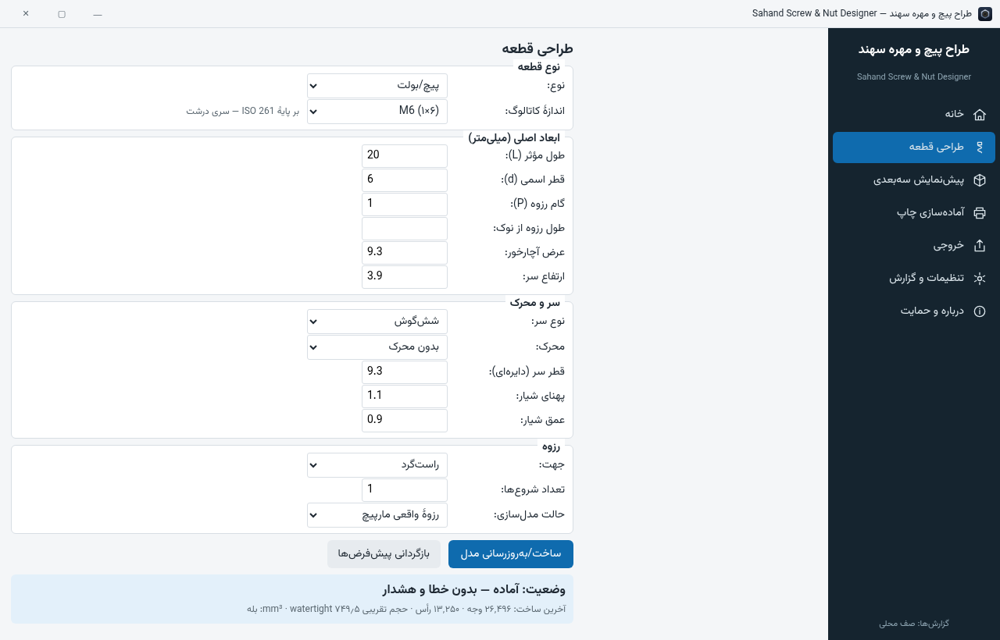 |
| 🧊 پیش‌نمایش سه‌بعدی — مش واقعی + اعتبارسنجی هندسی | 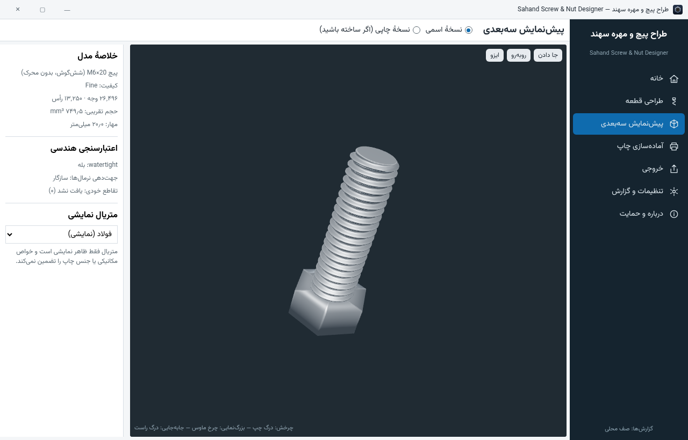 |
| 🖨️ آماده‌سازی چاپ — پروفایل فرایند + جدول تفاوت | 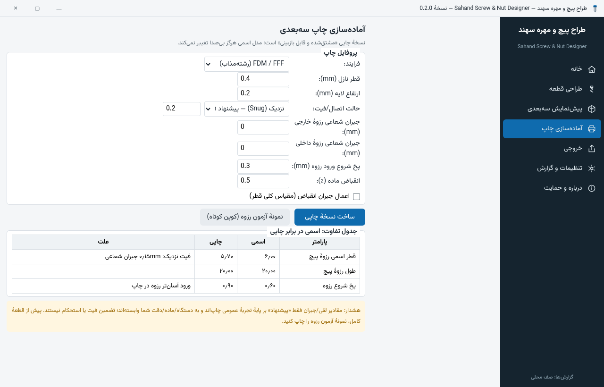 |
| 📤 خروجی — ماتریس صادقانهٔ فرمت‌ها | 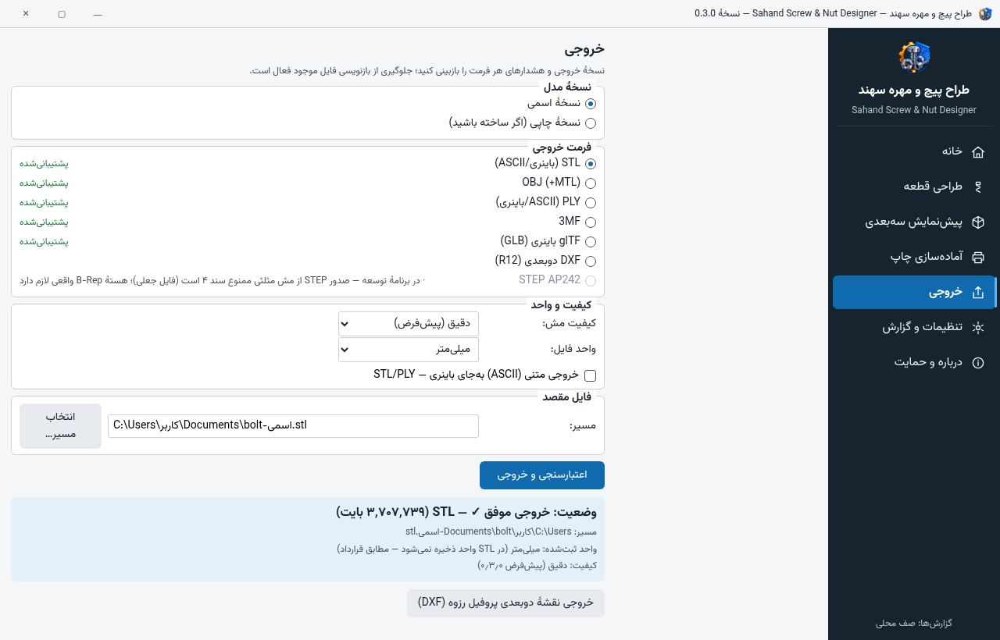 |
| ⚙️ تنظیمات و گزارش — صف محلی، SMTP، DPAPI | 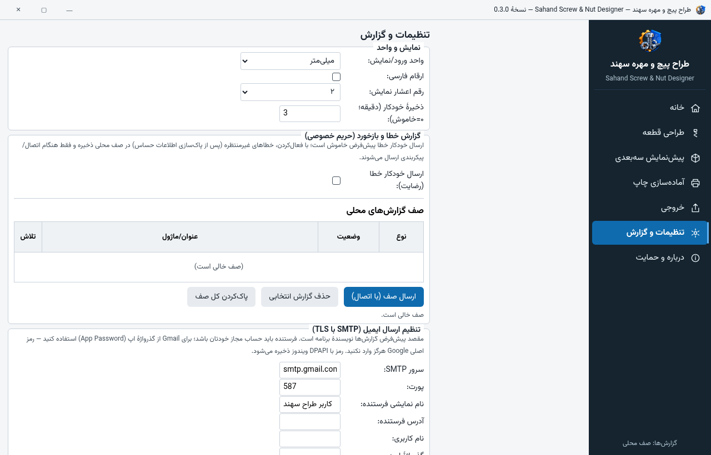 |
| ℹ️ درباره و حمایت — شناسنامه و کارت پوشیده | 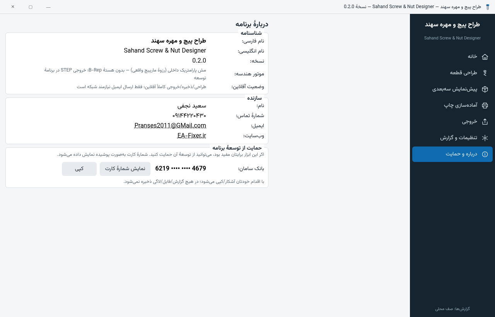 |

---

## 🚀 شروع سریع

### 🖱️ برنامهٔ روان (ویندوز)

1. بستهٔ نصب یا پرتابل را از [رلیزها](https://github.com/pranses2011/Sahand_Screw_Maker/releases) بگیرید — نیازی به نصب .NET نیست.
2. از «خانه» یک **پیچ جدید از کاتالوگ ISO** بسازید یا نمونهٔ آماده را باز کنید.
3. ابعاد/رزوه را تنظیم و مدل را بسازید؛ **اعتبارسنجی هندسی** همان لحظه نتیجه را می‌گوید.
4. در صورت نیاز **نسخهٔ چاپی** با جبران‌ها مشتق کنید و **جدول تفاوت** را ببینید.
5. از بخش «خروجی» با فرمت و کیفیت دلخواه، فایل بگیرید.

### ⌨️ ابزار خط فرمان (ویندوز و لینوکس)

```bash
# ساخت پیچ شش‌گوش M6×20 با خروجی STL
ssnd-cli generate --part bolt --size M6 --length 20 --head Hex --export STL --out bolt.ssnd

# مهرهٔ M8 با رزوهٔ داخلی واقعی + خروجی 3MF
ssnd-cli generate --part nut --size M8 --export 3MF --out nut.ssnd

# مجموعهٔ جفت با واشر
ssnd-cli generate --part assembly --size M6 --length 20 --washer --export OBJ --out asm.ssnd

# کوپن آزمون رزوه (۴ گام) برای تنظیم فیت پیش از چاپ کامل
ssnd-cli coupon --size M6 --export STL --out coupon.ssnd

# فهرست کاتالوگ و اعتبارسنجی پروژه
ssnd-cli catalog --family metric
ssnd-cli validate --in bolt.ssnd
```

خروجی واقعی اجرا روی لینوکس (پیام‌های واقعی برنامه):

```text
ذخیره شد: bolt.ssnd
خروجی STL (26496 وجه، 13250 رأس): 1324884 بایت
اعتبارسنجی مش: watertight=True, جهت‌دهی=True, تقاطع‌خودی=0
حجم تقریبی: 749.49 mm³
```

### 🔨 ساخت از سورس

```bash
git clone https://github.com/pranses2011/Sahand_Screw_Maker.git
cd Sahand_Screw_Maker
dotnet build SahandScrewMaker.sln        # بیلد ۱۱ پروژه — ۰ خطا/۰ هشدار
dotnet test SahandScrewMaker.sln          # ۱۱۳ آزمون
dotnet publish src/Sahand.App/Sahand.App.csproj -c Release -r win-x64 --self-contained true -o publish/app-win
```

راهنمای کامل و بستهٔ ویندوز: [docs/BUILD-FA.md](docs/BUILD-FA.md)

---

## 🧰 قابلیت‌ها

| | قابلیت | جزئیات |
|---|---|---|
| 🧵 | **رزوهٔ واقعی مارپیچ** | ISO متریک درشت/ریز، UNC، پروفیل سفارشی، چندشروع (`lead = pitch × starts`)، چپ‌گرد، مخروطی — با ساخت watertight، نه پس‌پردازش |
| 🔩 | **قطعات** | پیچ (شش‌گوش/آلن/خزینه/نیم‌گرد)، مهرهٔ شش‌گوش/جام با رزوهٔ داخلی، واشر، میل رزوه‌دار، **مجموعهٔ جفت با سازگارسنجی** |
| ⚙️ | **محرک‌ها** | حفرهٔ آلن، شیار تخت، شیار صلیبی فیلیپس — روی سرهای مجاز |
| 🧮 | **ورود مهندسی** | ارقام فارسی/لاتین، کسر اینچ (مثل `1/4-20`)، تبدیل دقیق mm↔inch بدون گردکردن بی‌صدا |
| 🖨️ | **نسخهٔ چاپی** | مشتق بدون دست‌زدن به نسخهٔ اسمی، جبران‌های FDM/SLA/SLS، جدول تفاوت + کوپن آزمون |
| 📤 | **خروجی‌ها** | STL باینری/ASCII، OBJ، PLY، 3MF، GLB، DXF دوبعدی — با آزمون رفت‌وبرگشت از خوانندهٔ مستقل |
| 📊 | **اطلاعات مهندسی** | حجم/جرم تقریبی (قضیهٔ گردش)، bbox، شمارش وجه/رأس — با برچسب «تقریبی» |
| ✅ | **اعتبارسنجی صادقانه** | رد ورودی نامعتبر با پیام فارسیِ قابل‌اقدام؛ ممنوعیت «موفق» کاذب در CLI و UI |
| 📧 | **گزارش و ایمیل آگاهانه** | صف محلی آفلاین، redaction راز/کارت/مسیر، SMTP خام با STARTTLS اجباری، DPAPI |
| ↩️ | **Undo/Redo** | زیرساخت پشتهٔ فرمان + بازیابی خودکار پس از crash |
| 🌐 | **کاملاً آفلاین** | طراحی/ذخیره/خروجی بدون اینترنت؛ ایمیل فقط با رضایت و تنظیم صریح کاربر |

---

## 📊 فرمت‌های خروجی — ماتریس صادقانه

| فرمت | وضعیت | یادداشت |
|---|---|---|
| STL (باینری/ASCII) | ✅ پایدار | آزمون رفت‌وبرگشت با خوانندهٔ مستقل |
| OBJ (+MTL) | ✅ پایدار | واحدها در نام/گزارش ثبت می‌شود |
| PLY | ✅ پایدار | — |
| 3MF | ✅ پایدار | آزمون رفت‌وبرگشت + تفاوت واقعی presetهای کیفیت |
| GLB | ✅ پایدار | — |
| DXF (R12) | ✅ پایدار | پروفیل دوبعدی رزوه/نمای جانبی — جدا از فهرست سه‌بعدی |
| STEP AP242 | 🕒 برنامهٔ توسعه | نیازمند هستهٔ B-Rep؛ **تولید STEP جعلی از مش صریحاً رد می‌شود** |

---

## 🧪 کیفیت

| | |
|---|---|
| بیلد (۱۱ پروژه) | ✅ **۰ خطا · ۰ هشدار** |
| آزمون‌ها | ✅ **۱۱۳/۱۱۳ سبز** — دامنه ۴۳ · هندسه ۲۵ · خروجی‌گیرها ۱۶ · گزارش ۱۹ · یکپارچگی CLI ۱۰ |
| watertight | ✅ همهٔ ترکیب‌های مجاز سر/محرک در آزمون‌ها |
| امنیت `.ssnd` | ✅ دفاع ZIP-bomb و مسیر-traversal |

```bash
dotnet test SahandScrewMaker.sln   # اجرای کامل ۱۱۳ آزمون
```

گزارش کامل پوشش ماتریس پذیرش: [docs/TEST-REPORT-FA.md](docs/TEST-REPORT-FA.md)

---

## 🔒 آفلاین و حریم خصوصی

- 🚫 **بدون تله‌متری، بدون ارسال داده، بدون دانلود زمانِ اجرا** — همهٔ مسیرهای طراحی/ذخیره/خروجی آفلاین‌اند.
- 📧 ایمیل خطا/بازخورد فقط با **رضایت صریح + پیکربندی + اتصال** ارسال می‌شود؛ در حالت آفلاین در **صف محلی** می‌ماند.
- 🧹 Redaction خودکار راز/شمارهٔ کارت/مسیر/IP در متن گزارش‌ها.
- 🔑 رمز SMTP با **DPAPI** ویندوز ذخیره می‌شود (پشت اینترفیس، جدا از منطق).
- 💳 شمارهٔ کارت حمایت در صفحهٔ «درباره» به‌صورت **پوشیده** نمایش داده می‌شود؛ آشکارسازی/کپی با اقدام آگاهانهٔ کاربر است.

جزئیات: [docs/PRIVACY-FA.md](docs/PRIVACY-FA.md)

---

## 🗂️ ساختار مخزن

```text
Sahand_Screw_Maker/
├── src/
│   ├── Sahand.Core/        # دامنه: رزوه، قطعات، واحد، اعتبارسنجی، کاتالوگ، .ssnd
│   ├── Sahand.Geometry/    # موتور مش: جاروب مارپیچ، سازنده‌ها، اعتبارسنجی watertight
│   ├── Sahand.Exporters/   # STL/OBJ/PLY/3MF/GLB/DXF + خوانندهٔ round-trip
│   ├── Sahand.Reporting/   # صف گزارش، redaction، SMTP خام امن
│   ├── Sahand.Cli/         # ssnd-cli — اتوماسیون بدون رابط
│   └── Sahand.App/         # WPF فارسی RTL + وزیرمتن (OFL)
├── tests/                  # ۵ پروژهٔ xUnit — ۱۱۳ آزمون
├── samples/                # ۴ پروژهٔ نمونهٔ .ssnd
├── installer/              # اسکریپت NSIS نصب‌کنندهٔ فارسی
├── docs/                   # مستندات فارسی + assets (رندرها/UI)
├── prompts/                # اسناد مشخصات اولیهٔ پروژه
└── analysis/               # تحلیل عامل پیش از پیاده‌سازی
```

---

## 🗺️ نقشهٔ راه

- [x] هستهٔ پارامتریک + رزوهٔ مارپیچ واقعی
- [x] ۶ فرمت خروجی + آزمون رفت‌وبرگشت
- [x] نسخهٔ چاپی + کوپن آزمون + CLI
- [x] رلیز آفلاین ویندوز (۰٫۱٫۰) + رفع کرش‌ها و رصد خطای سراسری (۰٫۲٫۰)
- [ ] تأیید بصری ویندوز توسط کارفرما
- [ ] کاتالوگ کامل‌تر: Whitworth، NPT، BSPP، ACME
- [ ] Torx و محرک‌های امنیتی + سرهای خاص
- [ ] STEP AP242 با هستهٔ B-Rep

---

## 📚 مستندات

| سند | موضوع |
|---|---|
| [راهنمای کاربر](docs/USER-GUIDE-FA.md) | گردش‌کار طراحی، رزوه، خروجی، چاپ، ایمیل و عیب‌یابی |
| [راهنمای ساخت](docs/BUILD-FA.md) | ساختار راه‌حل، وابستگی‌ها، publish ویندوز |
| [تاریخچهٔ تغییرات](docs/CHANGELOG-FA.md) | تغییرات نسخه‌ها (۰٫۱٫۰ و ۰٫۲٫۰) |
| [گزارش بازبینی ۰٫۲٫۰](analysis/01-AUDIT-AND-IMPROVEMENTS-FA.md) | ریشه‌یابی کرش‌ها، فهرست نواقص و برنامهٔ بهبود |
| [راهنمای توسعه‌دهنده](docs/DEVELOPER-FA.md) | معماری لایه‌ای، مدل ریاضی رزوه، قانون کامنت |
| [ماتریس فرمت‌ها](docs/FORMATS-AND-STATUS-FA.md) | وضعیت صادقانهٔ هر فرمت خروجی |
| [گزارش آزمون](docs/TEST-REPORT-FA.md) | ۱۱۳ آزمون، پوشش ماتریس پذیرش، محدودیت‌ها |
| [حریم خصوصی](docs/PRIVACY-FA.md) | رضایت، پاک‌سازی، DPAPI و کارت پوشیده |
| [پرامپت مادر](PROMPT.md) | اسناد مشخصات اولیهٔ پروژه (منبع الزامات) |

---

## ⚠️ محدودیت‌های صادقانهٔ نسخهٔ ۰٫۲٫۰

- **اجرای بصری WPF** روی ویندوز واقعی باید تأیید شود (توسعه روی Linux، بیلد سبز؛ تصاویر رابط، بازتولید وفادار قالب‌های XAML‌اند). کرش‌های گزارش‌شدهٔ ۰٫۱٫۰ با ریشهٔ مشخص رفع شده‌اند و در صورت مشاهدهٔ خطای جدید، فایل `crash-log.txt` (پوشهٔ دادهٔ برنامه) اثر ماندگار دارد.
- **نصب‌کنندهٔ NSIS** روی Linux کامپایل شده؛ فرایند نصب روی ویندوز باید آزموده شود.
- کاتالوگ دادهٔ آماده فقط **ISO متریک و UNC** است (هر دو از UI در دسترس‌اند)؛ خانواده‌های دیگر پروفیل بدون کاتالوگ دارند.
- شیار روی سر شش‌گوش/خزینه و Torx/محرک امنیتی در **برنامهٔ توسعه**اند و در اعتبارسنجی صادقانه رد می‌شوند.
- تقاطع خودی مش «هیوریستیکی» است (کشف قطعی تضمین‌نشده) — در کد مستند شده.

---

## 📜 مجوز و سپاس

- **کد:** مالک کارفرما — [LICENSE](LICENSE)
- **فونت وزیرمتن** نسخهٔ ۳۳٫۰۰۳ اثر [راستی‌کردار](https://github.com/rastikerdar/vazirmatn) با مجوز [OFL](src/Sahand.App/Fonts/OFL-Vazirmatn.txt) — استاتیک همراه بسته، بدون نیاز به نصب
- این پروژه از یک «بستهٔ پرامپت توسعه» آغاز شد؛ اسناد الزامات در [PROMPT.md](PROMPT.md) و تحلیل پیش از پیاده‌سازی در [analysis/00-AGENT-ANALYSIS.md](analysis/00-AGENT-ANALYSIS.md) موجود است.

</div>
