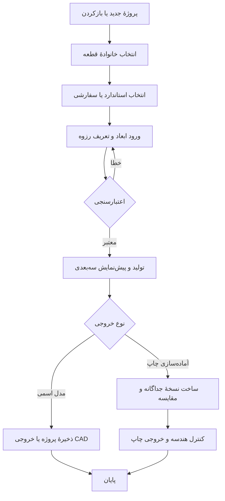

# 🎨 ۲. رابط کاربری، تجربهٔ کاربری و فارسی‌سازی

[↩ بازگشت به پرامپت مادر](../PROMPT.md) · [چشم‌انداز محصول](01-product-scope.md) · [← معماری و آفلاین](05-architecture-offline-privacy.md)

## ۲.۱. زبان، راست‌چین و تایپوگرافی

- فارسی زبان پیش‌فرض تمام صفحه‌ها، پیام‌ها، تنظیمات، راهنما، نصب‌کننده و خطاهای قابل نمایش باشد.
- جهت صفحه و چیدمان `Right-to-Left` واقعی باشد؛ فقط متن را راست‌چین نکن. ترتیب ستون‌ها، breadcrumb، منو، پنل‌ها، فلش‌های جهت‌دار و حرکت focus با RTL سازگار شوند.
- در فیلدهای عددی/ابعاد، نمایش کاراکترهای لاتین و علائم `.`، `-`، `/`، `×` و کد استاندارد ممکن است به LTR نیاز داشته باشد. هر فیلد جهت مناسب خودش را بگیرد تا رقم و واحد جابه‌جا نشوند.
- از فونت **Vazirmatn / وزیرمتن** برای همهٔ متن‌ها استفاده کن؛ نسخه‌های وزنِ لازم را همراه برنامه بسته‌بندی کن. روی نصب‌بودن فونت در Windows تکیه نکن. در صورت امکان فایل‌های ایستای سازگار با فناوری UI را به‌جای وابستگی به Variable Font به‌کار ببر.
- مجوز فونت (از جمله فایل مجوز متن‌باز، در صورت استفاده از نسخهٔ OFL) در بستهٔ توزیع و صفحهٔ مجوزها درج شود. فایل فونت را از منبع معتبر بگیر؛ دانلود در زمان اجرا ممنوع.
- گزینهٔ نمایش ارقام فارسی یا لاتین و جداکنندهٔ اعشارِ متناسب با انتخاب کاربر فراهم باشد؛ مقدار عددی، خروجی CAD و واحد هرگز بر اساس ظاهرِ رقم حدس زده نشوند.

## ۲.۲. معماری ناوبری

پیشنهادِ نوار کناری راست یا ناوبری جمع‌وجور با عنوان و آیکون روشن. متن فارسی باید در همهٔ گزینه‌ها قابل مشاهده یا با tooltip قابل دسترسی باشد.

| بخش | کارکرد |
|---|---|
| 🏠 خانه | ایجاد پروژه، بازکردن اخیر، پروژه‌های نمونهٔ مجاز و دسترسی سریع به خروجی/چاپ |
| 🔩 طراحی قطعه | انتخاب نوع پیچ، مهره، استادبولت، واشر یا قطعهٔ سفارشی |
| 🧵 رزوه و اندازه | تعریف استاندارد/پروفیل، قطرها، گام، پیشروی، جهت و کلاس تلرانس |
| 🧊 پیش‌نمایش سه‌بعدی | بررسی مدل، اندازه‌ها، جهت‌گیری و نسخهٔ اسمی یا چاپی |
| 🖨️ آماده‌سازی چاپ | انتخاب فرایند/پروفایل، لقی‌ها و تغییرهای چاپ با مقایسهٔ مدل |
| 📤 خروجی | انتخاب فرمت و کیفیت، مسیر، نام فایل و اعتبارسنجی پیش از ذخیره |
| ⚙️ تنظیمات | زبان ارقام، واحد پیش‌فرض، نمایش، مسیرها، حریم خصوصی و تنظیمات ایمیل |
| ℹ️ درباره و حمایت | نام برنامه، نسخه، اطلاعات سازنده و بخش حمایت؛ کارت پوشیده در حالت اولیه |

این فهرست راهنمای UX است؛ در پنجرهٔ کوچک، ناوبری می‌تواند جمع شود، اما دسترسی به بخش‌ها و برچسب‌ها نباید از بین برود.

## ۲.۳. گردش کار طراحی

در هر مرحله امکان بازگشت، اصلاح، ذخیره و لغو عملیات طولانی وجود داشته باشد.

## ۲.۴. پنجرهٔ طراحی قطعه

طرح پیشنهادی: پنل پارامترها در راست/چپِ قابل تنظیم با عنوان فارسی، نمای سه‌بعدیِ بزرگ در بخش اصلی و نوار وضعیت پایین. در RTL پنل فرم در سمت راست پیشنهاد می‌شود؛ چیدمان باید قابل تغییر باشد اگر موتور/طراحی پلتفرم دلیل موجه دارد.

- عنوان نوع انتخاب‌شده، استاندارد یا نشان «سفارشی»، و وضعیت اعتبارسنجی.
- گروه‌بندی فیلدها: **ابعاد اصلی**، **رزوه**، **سر و شیار ابزار**، **جزئیات/پخ‌ها**، **تلرانس**، **چاپ سه‌بعدی**.
- برچسب فارسی + نماد کوتاه مهندسی/واحد در کنار فیلد: مثل «قطر اسمی (d) — mm». توضیح در tooltip یا راهنمای کنار فیلد.
- فیلدهای وابسته فقط زمانی فعال باشند که مربوط باشند؛ مقدار غیرفعال از پروژه پاک نشود مگر کاربر صریحاً نوع را عوض کند و پیامد آن را تأیید کند.
- خلاصهٔ زنده: طول کلی، اندازهٔ رزوه، مقدار تغییر چاپ، پیام خطا/هشدار و تعداد اجزا.
- دکمه‌های واضح: `ساخت/به‌روزرسانی مدل`، `بازگردانی`، `ذخیره` و `لغو عملیات`. عملیات طولانی indicator پیشرفت و امکان cancel داشته باشند.
- در صورت پشتیبانی واقعیِ موتور، درخت اجزا/ویژگی‌ها (بدنه، سر، شانه، رزوه، محرک، پخ/فیلت) با امکان انتخاب، مخفی/نمایش، ویرایش و خاموش‌کردن ویژگی اختیاری نشان بده. حذف یا suppress باید بازگشت‌پذیر و قابل undo باشد؛ رابط برای ویژگی‌های پشتیبانی‌نشده کنترل جعلی نسازد.

### رفتار فیلدها

1. مقدار خارج از محدوده به‌صورت inline و با توضیح قابل اصلاح نمایش داده شود؛ تنها رنگ قرمز کافی نیست.
2. از tooltipهای فارسی برای اصطلاح‌های فنی استفاده کن. اصطلاح‌هایی مثل قطر گام، پیشروی و مخروطی‌بودن تعریف کوتاه داشته باشند.
3. مقدارهای نمونه یا پیش‌فرض، برچسب «نمونه/پیش‌فرض» بگیرند و به‌اشتباه استاندارد قطعی جلوه نکنند.
4. جداکنندهٔ اعشار، تبدیل واحد و گردکردن هنگام ورود/نمایش شفاف باشد. دقت هندسه از دقت متن UI جدا باشد.
5. برای هر تغییر پرهزینه، پیش‌نمایش را debounce یا پس‌زمینه‌ای تولید کن؛ UI نباید هنگام ساخت رزوه قفل شود.

## ۲.۵. پیش‌نمایش گرافیکی

- مدل روشن و خوانا با پس‌زمینهٔ خنثی؛ طرح‌های تیره/روشن با کنتراست مناسب.
- کنترل ماوس/لمس: چرخش، zoom، pan و fit-to-view. کنترل‌ها و راهنمای کوتاه باید در دسترس و قابل تنظیم باشند.
- نمایش grid و محورها، قطب‌نمای XYZ، حالت نمای روبه‌رو/بالا/جانبی/ایزومتریک و perspective/orthographic.
- امکان روشن/خاموش‌کردن مش‌بندی، رزوهٔ نمایشی، رزوهٔ واقعی، برچسب اندازه‌ها و اجزای جداگانه.
- در مدل جفت، رنگ‌بندی متمایز برای پیچ و مهره و گزینهٔ نمایش فاصله/لقی؛ تداخل فقط وقتی با آزمون هندسی معتبر تشخیص داده شود گزارش شود.
- نسخهٔ چاپی از نسخهٔ اسمی به‌وضوح متمایز باشد؛ ترجیحاً نمای مقایسه‌ای یا overlay با فهرست تغییرهای ابعادی.
- پیام «در حال تولید هندسه» با وضعیت، لغو و خطای قابل فهم. خطای هسته را با stack trace خام به کاربر عادی نمایش نده.
- همهٔ کارکردها با صفحه‌کلید قابل دسترس باشند؛ رنگ تنها نشانهٔ وضعیت نباشد.

## ۲.۶. آیکون‌ها و المان‌های گرافیکی

این سند و خود برنامه باید از نشانه‌های دیداری کمک بگیرند. برای UI نهایی:

- مجموعهٔ آیکون برداریِ سبک (مثلاً SVG/آیکون‌های Fluent یا Lucide، فقط پس از بررسی سازگاری و مجوز) یا آیکون بومی با کیفیت یکنواخت انتخاب شود.
- در رابط اصلی، آیکون همراه برچسب متنی باشد؛ emoji به‌تنهایی جایگزین برچسب یا ابزار حرفه‌ای نشود، چون شکل emoji در سیستم‌ها متفاوت است.
- نمادهای پیشنهادی: 🏠 خانه، 🔩 قطعه، 🧵 رزوه، 🧊 نما، 🖨️ چاپ، 📤 خروجی، 💾 ذخیره، ⚠️ هشدار و ℹ️ اطلاعات. برای نسخهٔ اجرایی از SVG/آیکون خطیِ یک‌دست استفاده کن.
- از تصویر تزئینیِ سنگین یا آنلاین استفاده نکن. در صفحهٔ خانه می‌توان از تصویر/آیکون اختصاصی پیچ‌ومهره با زمینهٔ ساده، نمودار گردش کار و تصویر کوچک مدل واقعی تولیدشده استفاده کرد.
- وضعیت‌ها باید معنا داشته باشند: موفقیت، هشدار، خطا، آفلاین، صف‌شده و در حال ارسال؛ از رنگ، آیکون، متن و tooltip به‌صورت هم‌زمان بهره ببر.
- منابع گرافیکی، آیکون‌ها و فونت‌های شخص ثالث باید مجوز ثبت‌شده داشته باشند و در بخش مجوزها ذکر شوند.

## ۲.۷. پنجره‌های فرعی

### انتخاب فرمت و کیفیت خروجی

نوع فایل، واحد، تنظیمات کیفیت مرتبط با آن فرمت، مسیر و نام، خلاصهٔ هشدارها و دکمهٔ «اعتبارسنجی و خروجی» را نشان بده. کنترل کیفیتی که برای فرمت انتخاب‌شده اثر ندارد مخفی یا با توضیح غیرفعال باشد.

### پروفایل چاپ

فرایند چاپ، جنس/پروفایل ماده، دقت XY یا نازل/رزولوشن، لایه، لقی، جهت/پیشنهاد جهت‌گیری، حداقل ضخامت و جبران انقباض را از هم تفکیک کن. مقدار نمونه را «پیشنهاد» بنام، نه تضمین.

### گزارش خطا و پیشنهاد

پیش از ارسال، نوع گزارش، متن و داده‌های ضمیمه را به کاربر نشان بده. گزینه‌های ویرایش، حذف اطلاعات شخصی، لغو و صف‌بندی آفلاین فراهم شود. وضعیت «صف شد»، «در انتظار اتصال»، «ارسال شد» و «ناموفق» دقیق باشد.

### تنظیمات ارسال ایمیل

راهنمای مرحله‌ای برای تنظیم SMTP/سرویس ارسال با TLS، تست اتصال و مدیریت امن رمز/توکن. مقصد گزارش پیش‌فرض نویسنده باشد؛ برنامه نباید در صورت نبود پیکربندی، دکمهٔ ارسال موفق کاذب نشان دهد.

## ۲.۸. دسترس‌پذیری و تجربهٔ پایدار

- تب‌گردی و ترتیب focus با راست‌چین سازگار؛ focus واضح، میانبرهای صفحه‌کلید و دسترسی به tooltip.
- اندازهٔ متن قابل بزرگ‌نمایی؛ چیدمان در رزولوشن معمول لپ‌تاپ و مقیاس Windows 125–200٪ قابل استفاده باشد.
- کنتراست خوانا، عدم وابستگی به رنگ تنها، متن جایگزین برای تصویر/نمودار، پیام خطای فارسی و قابل اقدام.
- خطای اعتبارسنجی نزدیک همان فیلد و خلاصهٔ خطا در ابتدای فرم؛ پس از اصلاح موفق، پیام خطا برداشته شود.
- ذخیره و بازشدن پروژهٔ فارسی و مسیرهای دارای نویسهٔ فارسی/فاصله درست کار کند.
- واژه‌نامهٔ کوتاه یکدست برای اصطلاحات اصلی بساز و در همهٔ صفحات همان معادل‌ها را به‌کار ببر.

## ۲.۹. لحن و متن‌های UI

لحن روشن، محترمانه، کوتاه و غیرترساننده باشد. متن‌ها از پیام خطای خام کتابخانه، متن ترجمه‌نشده، اصطلاح مبهم و وعدهٔ غیرواقعی اجتناب کنند.

نمونهٔ پیام مناسب: «گام رزوه با خانوادهٔ انتخاب‌شده سازگار نیست. مقدار را اصلاح کنید یا رزوهٔ سفارشی را انتخاب کنید.»

نمونهٔ پیام نامناسب: «خطای نامشخص! مدل نشد» یا «مدل کاملاً استاندارد است» بدون منبع و آزمون.
